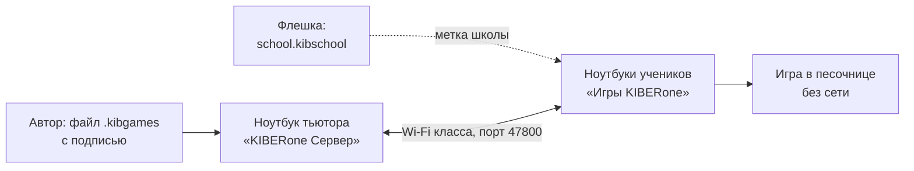

# K1 Игры

 

Учебные игры кибершколы KIBERone на 30 минут урока. Тьютор публикует игры на своём ноутбуке, ноутбуки учеников берут их по Wi-Fi класса и запускают в песочнице: без интернета, без доступа к файлам и устройствам. Дети ставят играм звёзды, тьютор видит, что нравится. Авторы: Влад и Кирилл, тьюторы KIBERone.

## Установка в трёх шагах

1. На ноутбук тьютора — `KIBERone-Server-Setup-1.2.0.exe`, создать школу, записать код восстановления.
2. «Школа» → «Сохранить school.kibschool» на флешку рядом с `KIBERone-Games-Setup-1.2.0.exe`.
3. На каждый ноутбук ученика под администратором — `KIBERone-Games-Setup-1.2.0.exe` с этой флешки.

Подробно, с первым занятием и сбоями сети: [`docs/ustanovka.md`](docs/ustanovka.md).

| Документ | Для кого |
| --- | --- |
| [`docs/ustanovka.md`](docs/ustanovka.md) | Тьютор: установка, первое занятие, что делать, если сломалось |
| [`docs/kak-sdelat-igru.md`](docs/kak-sdelat-igru.md) | Автор игры: `kibgame.json`, обложка, режимы, `kibpack` |
| [`docs/bezopasnost.md`](docs/bezopasnost.md) | Что обещаем и что нет, какие данные где лежат |
| [`docs/kak-ustroeno.md`](docs/kak-ustroeno.md) | Разработчик: компоненты, сеть, API, установщики |
| [`docs/plan.md`](docs/plan.md) | Этапы, статус, что дальше |
| [`app/`](app/README.md) | Код, тесты, сборка |
| [`games/`](games/README.md) | Наши игры: Киберпочта, Взломай сейф |
| [`docs/stil-k1.md`](docs/stil-k1.md), [`docs/adr/`](docs/adr/) | Стиль интерфейса и решения по архитектуре |
