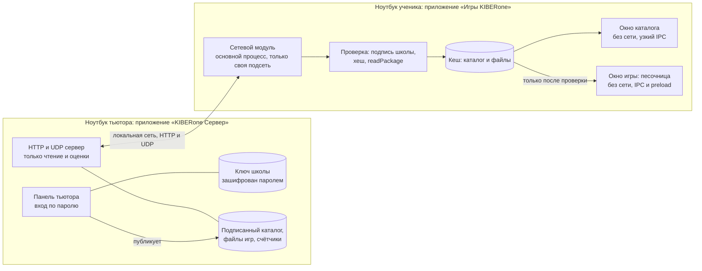
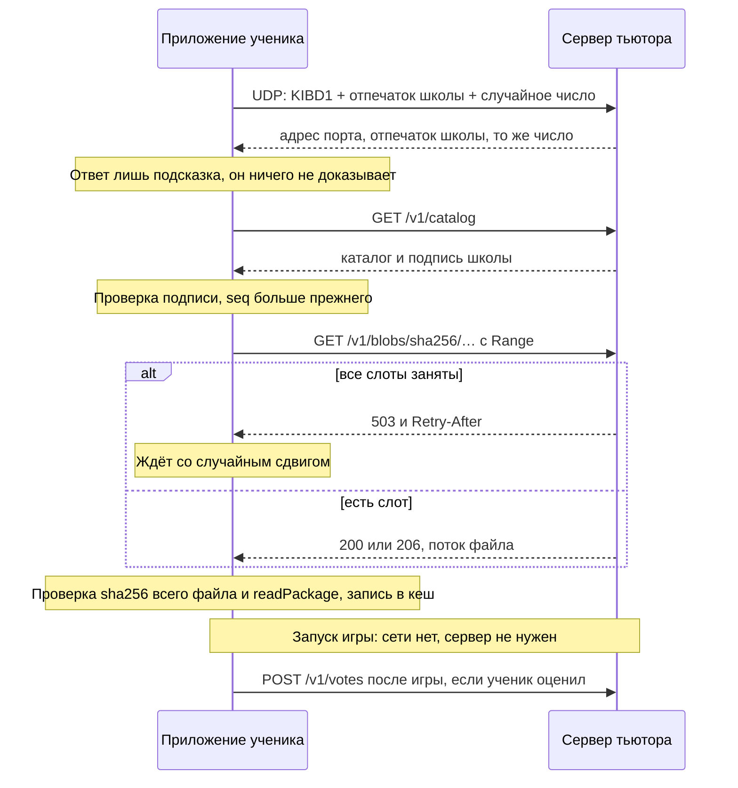
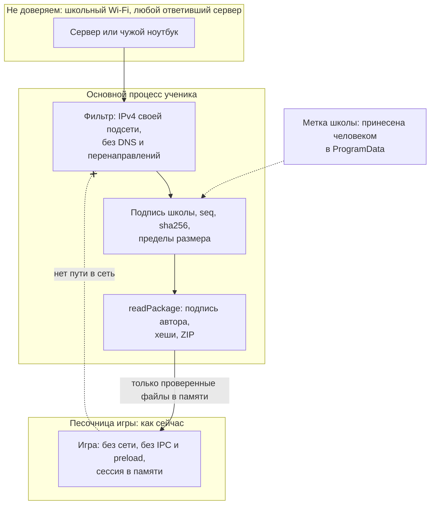

# ADR-0002: Локальный маркетплейс игр в сети школы

**Статус:** принято 02.11.2026, тип учётных записей детей уточняется проверкой (раздел 12). Этап М1 начинается после отчёта с Windows без критичных провалов
**Дата:** 02.11.2026
**Решают:** Влад, Кирилл
**Уточняет:** ADR-0001, заменяет его этап 5 и обещание «приложение вообще не ходит в сеть» (см. раздел 1.4)

## Коротко

Тьютор публикует игры на своём ноутбуке и подписывает каталог ключом школы. Ноутбуки учеников находят сервер широковещательным запросом, скачивают каталог и файлы по обычному HTTP, проверяют подпись школы и хеши, а игру запускают из локального кеша в той же песочнице, что и сейчас.

Главные решения:

- **Право администратора равно владению закрытым ключом школы.** Это не режим в интерфейсе. Приложение ученика не содержит ни кода сервера, ни ключа, ни поля для пароля.
- **Сервер ненадёжен по замыслу.** Подлинность каталога доказывает подпись, а не адрес и не канал. TLS поэтому не обязателен, и то, что он не защищает, названо прямо.
- **Режим равен именованной точке входа из подписанного манифеста.** Приложение узнаёт режим до запуска игры, поэтому канал «игра → приложение» не нужен и песочница не меняется.
- **Защита оценок ограничивает случайные и лёгкие накрутки.** От упорного ученика с собственной программой она только ограничивает ущерб. Анонимность и точный подсчёт в этой системе несовместимы.

К сегодняшнему вечеру маркетплейс не будет готов. На Windows сегодня проверяется нынешняя версия и сетевые условия (раздел 8).

## 1. Требования и допущения

### 1.1 Что делает система

| № | Требование |
| --- | --- |
| Ф1 | Ученик открывает каталог всех опубликованных игр и запускает любую |
| Ф2 | Публикует и снимает игры только тьютор |
| Ф3 | Ученик оценивает режим, приложение показывает самые популярные |
| Ф4 | Ноутбук находит сервер без ручного ввода, если сеть это позволяет |
| Ф5 | Файлы скачиваются в фоне, запущенная игра не обращается к серверу |

### 1.2 Качество

| Свойство | Цель |
| --- | --- |
| Масштаб | 15 учеников, один тьютор, десятки игр от 30 КБ до 200 МБ |
| Доступность | Скачанные игры работают без сервера и без интернета |
| Каталог при входе | Показ из кеша сразу, обновление за 3 с при живом сервере |
| Приватность | Нет имён, аккаунтов и журналов с адресами на диске |
| Стоимость | Нет внешней инфраструктуры и платных сервисов |

### 1.3 Допущения

Если одно из них неверно, решение нужно пересмотреть. Как проверить каждое, сказано в разделе 8.

| № | Допущение | Что будет, если неверно |
| --- | --- | --- |
| Д1 | Ноутбуки в Wi-Fi школы видят друг друга | При изоляции клиентов не работает ни обнаружение, ни HTTP. Нужна своя точка доступа или раздача с ноутбука тьютора |
| Д2 | Адреса сети входят в 10/8, 172.16/12 или 192.168/16 | Сетевой фильтр отвергнет сервер, нужно расширять список |
| Д3 | У тьютора есть права администратора на ноутбуках. **Подтверждено Владом 02.11.2026** | |
| Д4 | У детей обычная учётная запись. **По словам Влада, это пользователи без пароля, не администраторы. Точно проверяется на Windows** | Если запись окажется администраторской или у администратора нет пароля, ребёнок может подменить доверие на своём ноутбуке (раздел 12, У8) |
| Д5 | Сервер работает на Windows 11, на Linux только разработка. **Подтверждено Владом 02.11.2026** | |
| Д6 | Скорость Wi-Fi от 20 до 150 Мбит/с. Это оценка, а не замер | Пересчитать раздел 6 |

### 1.4 Что меняется в обещаниях ADR-0001

| Было | Стало |
| --- | --- |
| «Приложению вообще не нужна сеть» | Без настроенной школы сети по-прежнему нет, критерий К4 (0 пакетов) остаётся. С настроенной школой сеть есть только у основного процесса и только к адресам своей подсети |
| «Без следов на диске» | Обещание сужается до данных ребёнка: хранилища игр остаются в памяти. Файлы игр и подписанный каталог теперь кешируются на диске |
| Игры неизвестного автора запускаются после предупреждения ученику | На настроенном ноутбуке предупреждения нет, решение принимает тьютор при публикации. Открыть посторонний файл там нельзя |
| Этап 5: раздача по коду класса | Заменён этим документом |
| Этап 4: «установщик без прав администратора» | В `package.json` уже `perMachine: true`, и здесь это нужно: метка доверия и правило брандмауэра требуют прав. ADR-0001 устарел в этом пункте |

## 2. Компоненты и потоки данных

### 2.1 Компоненты



Код лежит в одном репозитории, а собирается в два установщика:

| Папка | Что содержит | В сборке ученика | В сборке тьютора |
| --- | --- | --- | --- |
| `app/shared/` | Формат, подпись каталога | да | да |
| `app/desktop/sandbox.js` | Песочница, без изменения защиты | да | да, для пробного запуска игры |
| `app/desktop/client/` | Обнаружение, загрузка, кеш, окно каталога | да | нет |
| `app/desktop/tutor/` | Ключ школы, публикация, сервер | **нет** | да |

### 2.2 Потоки данных

**Загрузка игры (только на ноутбуке тьютора, без сети).**

1. Тьютор выбирает `.kibgames` в своей панели. Вход уже выполнен.
2. `readPackage` делает те же проверки, что и сейчас.
3. Панель показывает игру, отпечаток ключа автора и предупреждение, если ключа нет в списке доверия школы. Тьютор может открыть игру в песочнице и посмотреть её.
4. Если `id` уже есть с другим ключом автора, публикация запрещается, пока тьютор не подтвердит замену отдельно.
5. Файл копируется в `blobs/<sha256>.kibgames`. Новый каталог получает больший `seq` и подпись ключом школы.

**Каталог.**

1. Приложение показывает каталог из кеша, если он есть.
2. Адрес берётся из памяти, иначе из обнаружения (раздел 3.5).
3. `GET /v1/catalog` с `If-None-Match`. Ответ 304 весит примерно 300 байт.
4. Новый каталог принимается, только если подпись верна и `seq` больше сохранённого.
5. Опрос каждые 60 с со случайным сдвигом до 15 с. На время запущенной игры опрос останавливается.

**Фоновая загрузка.**



**Запуск.** Каталог показывает кнопку «Играть» для игры в кеше. Перед запуском приложение снова выполняет `readPackage` и сверяет `sha256` файла и ключ автора с каталогом. Игра открывается через существующий `openGame`, окно получает адрес `kibgame://<id>/<entry>?mode=<режим>`. Сеть на это время останавливается полностью: нет опроса и загрузок, поэтому при запущенной игре приложение не шлёт ни одного пакета.

**Оценка.** После закрытия окна игры приложение предлагает три варианта или «Пропустить». Сама игра в этом не участвует. Если сервера нет, оценка ждёт в памяти и пропадает при выходе из приложения. На диск она не пишется.

## 3. Роли, API, данные

### 3.1 Проверка гипотезы о ролях

Гипотеза подтверждается: сервер на ноутбуке тьютора, публикует только тьютор, детям доступны каталог, запуск и оценки. Для неё нужно четыре уточнения.

1. **Администратор определяется ключом, а не режимом.** Даже если ребёнок включит панель тьютора на чужой копии программы, он создаст свою школу, которой не доверяет ни один ноутбук.
2. **Сетевого API администратора нет.** Публикация идёт только в локальном окне на ноутбуке тьютора, поэтому пароль никогда не проходит по Wi-Fi. Снимается и задача защиты пароля без TLS.
3. **Раздача работает при закрытой панели.** Каталог подписывается один раз при публикации. Ключ в памяти нужен только в этот момент, поэтому сервер может работать весь урок, пока ключ зашифрован.
4. **Слабое место гипотезы: закрытый ноутбук тьютора.** Уже скачанные игры продолжат работать, не будет только новых загрузок и оценок. Пока приложение раздаёт игры, оно удерживает ноутбук от сна (`powerSaveBlocker`), но закрытие крышки всё равно может усыпить его.

| Действие | Ученик | Тьютор, панель закрыта | Тьютор, вход выполнен |
| --- | --- | --- | --- |
| Смотреть каталог, играть, оценивать | да | да | да |
| Включить и выключить раздачу | нет | да | да |
| Опубликовать, снять игру, менять список доверия | нет | нет | да |
| Сбросить оценки, новое окно оценок | нет | нет | да |

### 3.2 Вход, утеря пароля, общий ноутбук

**Вход.** При создании школы приложение генерирует ключ Ed25519. На диске он лежит зашифрованным: AES-256-GCM с ключом из `scrypt` (N = 2^17, r = 8, p = 1), `crypto` из Node достаточно. Пароль минимум 10 знаков. Ошибки увеличивают задержку до 60 с. Через 10 минут бездействия ключ стирается из памяти и панель закрывается.

Защита Windows (`safeStorage`, DPAPI) не выбрана: она привязана к учётной записи Windows, и если под ней сидит ребёнок, не защищает ничего.

**Утеря пароля.**

| Что утеряно | Что происходит |
| --- | --- |
| Пароль, код восстановления цел | При создании школы показывается код из 26 знаков (128 бит), тьютор хранит его на бумаге не в классе. Код расшифровывает вторую копию ключа, после чего задаётся новый пароль |
| Пароль и код | Сброса нет, потому что нет сервиса, который мог бы его сделать. Создаётся новая школа и настраиваются все ноутбуки заново, примерно 15 × 1 минута. Файлы игр и оценки остаются |
| Ноутбук украден или ключ раскрыт | То же: новая школа и настройка ноутбуков. Старый ключ на ноутбуках заменяется установкой нового файла школы |

Резервная копия школы — это зашифрованный файл ключа и код. Копия же нужна второму тьютору.

**Как ребёнок не получит права.**

| Мера | От чего защищает |
| --- | --- |
| В сборке ученика нет панели, сервера и ключа | Не от чего получать права, проверяется списком файлов `app.asar` |
| На ноутбуке ученика пароль тьютора не вводится **никогда**. Правило для тьюторов | Игра на весь экран может нарисовать поддельное окно входа. Игра не передаст пароль, но ребёнок сможет его увидеть |
| Метка доверия лежит в `%ProgramData%`, пишется установщиком с правами администратора | Обычная учётная запись не может подменить школу, пока у администратора есть пароль (допущение Д4, раздел 12) |
| Настроенный ноутбук не открывает посторонние `.kibgames` и не читает `trusted-keys.json` | Сейчас этот файл лежит в `%APPDATA%`, и ребёнок может его править. Флешка с игрой не обойдёт каталог |
| Панель закрывается сама, ключ зашифрован | Ребёнок за ноутбуком тьютора. **Остаточный риск:** если тьютор отошёл при открытой панели в первые 10 минут, ребёнок сможет публиковать игры. Нужно блокировать Windows (Win+L) |

### 3.3 Настройка ноутбука и доверие

Настройка выполняется один раз и не требует сети. Панель тьютора создаёт файл `school.kibschool` с публичным ключом школы, названием и отпечатком. Файл лежит рядом с установщиком на флешке. Установщик работает с правами администратора и копирует файл в `%ProgramData%\KIBERone Games\school.json`. Приложение показывает отпечаток в окне «О программе», тьютор может сверить его с панелью.

Без этого файла приложение работает как сейчас: открывает файл, сети нет, К4 выполняется.

Секрета в файле нет: он содержит только публичный ключ. Доверие возникает потому, что файл принёс человек, а не сеть.

### 3.4 API

Базовый адрес `http://<IPv4>:47800` (порт условный). Сервер принимает только адреса своей подсети, отвергает запросы с заголовком `Origin` (защита от страниц в браузере) и слушает только интерфейс, выбранный тьютором. Журнала запросов нет.

| Метод | Путь | Ответ | Заметки |
| --- | --- | --- | --- |
| GET | `/v1/catalog` | `{ "payload": base64, "sig": base64 }` | `ETag` равен `seq`, поддерживается 304. До 2 МБ |
| GET | `/v1/blobs/sha256/<hex>` | Файл, 200 или 206 | Только `[0-9a-f]{64}`, поэтому пути файлов не участвуют. `Range`, `If-Range`, неизменяемый кеш. 503 с `Retry-After` при занятых слотах |
| GET | `/v1/ratings` | Счётчики по режимам с `n >= 5` | Не подписаны: это не команды и не код |
| POST | `/v1/votes` | 204, 400, 409 уже голосовал, 429 предел | Только JSON до 256 байт: `{ "game", "key", "mode", "value" }` |

Значок игры скачивается тем же путём `blobs`, его хеш есть в каталоге. Предел значка 64 КБ.

Содержимое `payload` (подписаны точные байты с префиксом `kibcatalog-v1\n`, чтобы подпись не подошла ни к чему другому):

```json
{
  "format": 1,
  "school": "отпечаток ключа школы",
  "seq": 1793620000,
  "games": [{
    "id": "kiberpochta",
    "version": "1.2.0",
    "title": "Киберпочта",
    "description": "…",
    "grades": "4–5 класс",
    "minutes": 30,
    "topic": "Кибербезопасность",
    "author": "Имя из списка доверия школы",
    "authorKey": "отпечаток ключа автора",
    "sha256": "хеш всего файла .kibgames",
    "bytes": 95000,
    "icon": "хеш значка или null",
    "prefetch": true,
    "modes": [{ "id": "default", "title": "Киберпочта" }]
  }]
}
```

`seq` равен `max(прежний + 1, unix-время)`, поэтому восстановленная из копии школа не окажется позади ноутбуков. Срока годности у каталога нет: панель обычно закрыта, и подписывать заново нечем.

### 3.5 Обнаружение сервера

Порядок попыток:

1. Последний рабочий адрес из кеша.
2. UDP-запрос на порт 47800 каждого активного интерфейса: на `255.255.255.255` и широковещательный адрес подсети. Сервер отвечает одному отправителю. Ответ не больше запроса, поэтому усиливать атаки нечем.
3. Через 15 с без ответа на экране: «Попроси тьютора назвать адрес» и поле ввода. Тьютор видит адрес в панели. Адрес проходит тот же фильтр подсети и запоминается.

Ответы без нужного отпечатка школы отбрасываются. Ответ не считается доказательством: приложение проверяет каталог каждого ответившего и берёт наибольший `seq`.

Когда сеть блокирует способ:

| Что заблокировано | Симптом | Что делать |
| --- | --- | --- |
| Широковещание на точке доступа | Нет ответа, а ping по адресу работает | Ввести адрес один раз. При постоянном адресе тьютора больше не понадобится. Лучше закрепить адрес в DHCP |
| Изоляция клиентов | Нет и ping | Адрес не поможет. Выключить изоляцию, принести свою точку доступа или включить мобильный хот-спот на ноутбуке тьютора |
| Брандмауэр на ноутбуке тьютора | Сервер виден только локально | Правило из установщика, см. раздел 3.7 |

### 3.6 Что считать режимом

В манифесте режимов нет, а `checkManifest` отвергает любое неизвестное поле. Проба подтвердила: `modes` сейчас даёт ошибку «Неизвестное поле манифеста». Это безопасный отказ, поэтому старое приложение не запустит новую игру по неверным правилам.

**Определение.** Режим — вариант запуска игры, который автор объявил в подписанном манифесте. Он имеет постоянный `id`, название и необязательную страницу входа. Игра без `modes` имеет один неявный режим `default`, и оценка относится ко всей игре.

```json
"modes": [
  { "id": "training", "title": "Тренировка" },
  { "id": "exam", "title": "Экзамен", "entry": "game/exam.html" }
]
```

| Вариант | Плюс | Минус |
| --- | --- | --- |
| **Точка входа из манифеста (выбран)** | Приложение знает режим до запуска. Обратный канал не нужен. Подпись защищает список | Меняется формат: необязательное поле. Переключение режима внутри игры не видно |
| Игра сообщает режим приложению | Точно знает, во что играли | Нужен канал из песочницы, это ослабляет защиту. Отклонён |
| Тьютор описывает режимы в каталоге | Формат не меняется | Режим не связан с кодом игры, игра не узнает выбор |

**Обоснование изменения формата.** Поле только описывает варианты запуска. Это не разрешение, и доступа оно не добавляет. `format` остаётся равным 1, потому что поле необязательное, а старые версии откажут. Новая проверка: 1–12 режимов, `id` по `^[a-z0-9-]{1,40}$`, `title` через существующую проверку текста, `entry` есть в `files` и начинается с `game/`. Значение `?mode=` собирает приложение только из `id` манифеста. Проба подтвердила, что `location.search` виден игре, а `serveGame` читает только путь.

### 3.7 Хранение

| Что | Где | Сколько | Содержит личные данные? |
| --- | --- | --- | --- |
| Зашифрованный ключ школы | Тьютор: `%LOCALAPPDATA%\KIBERone Server\school-key.enc` | Пока существует школа | Нет |
| Каталог и подпись, файлы игр | Тьютор: `…\catalog.json`, `…\blobs\` | Пока игра опубликована | Нет |
| Список доверия авторов | Тьютор: `…\trusted-keys.json` | Постоянно | Имена авторов игр, не детей |
| Счётчики оценок | Тьютор: `…\ratings.json` | Дневные наборы 90 дней, затем слияние в общий итог | Нет: дата, игра, режим, значение, количество. Времени и адреса нет |
| Хеш адреса для защиты от повторов | Тьютор: только память | До конца окна оценок, соль в памяти | Псевдоним на время занятия, не пишется на диск |
| Метка школы | Ученик: `%ProgramData%\KIBERone Games\school.json` | Постоянно | Нет |
| Кеш | Ученик: `%LOCALAPPDATA%\KIBERone Games\cache\` | Предел 5 ГБ, лишнее удаляется по давности. Снятая игра удаляется при следующем каталоге | Нет |
| `seq`, последний адрес сервера, настройки | Ученик: `…\state.json` | Постоянно | Нет |
| Хранилище игры | Ученик: только память | До закрытия окна | Может содержать всё, что ребёнок ввёл, но на диск и в сеть не попадает |
| Оценка без сервера | Ученик: только память | До закрытия приложения | Нет |

Файлы пишутся атомарно: временный файл и переименование. SQLite не нужен: это сотни записей в одном процессе, а `better-sqlite3` принёс бы нативную сборку под Electron. Рейтинг учеников с никами из старых планов сюда не входит.

**Никогда не покидает школьную сеть:** оценки, адреса, каталог, файлы игр. Приложение не содержит кода отправки на внешний адрес, телеметрии и автообновления. Переносить данные можно только вручную: например, тьютор может скопировать файл игры или резервную копию.

**Никогда не покидает ноутбук ученика:** всё, что ребёнок делает внутри игры. По сети идут только запросы каталога и файлов и анонимные оценки.

Правило брандмауэра есть только у установщика тьютора: вход TCP и UDP 47800 для программы, `remoteip=localsubnet`, для всех профилей сети, потому что школьный Wi-Fi часто определяется как общедоступный. Раздача выключена при каждом запуске, тьютор включает её сам и видит название интерфейса. На ноутбуках учеников входящих правил нет.

### 3.8 Оценки: что реально обеспечит защита

**Как считается.** Три варианта: не понравилось (1), нормально (2), очень понравилось (3). Звёзды от 1 до 5 у детей обычно скатываются к максимуму, но это наблюдение, а не замер, его стоит проверить на пилоте. Сортировка по `(сумма + 2·5) / (n + 5)`, чтобы один голос «3» не обгонял тридцать. Пока оценок меньше 5, показывается «мало оценок», а счёт не раскрывается.

**Окно оценок.** Начинается при включении раздачи или по кнопке «Новое занятие» и длится не дольше 120 минут.

| Мера | От чего защищает |
| --- | --- |
| Интерфейс предлагает оценку только после запуска режима и один раз за окно | Случайные и повторные нажатия |
| Один голос с адреса за окно на режим, по `HMAC(соль окна, адрес + режим)` в памяти | Перезапуск приложения и простой скрипт |
| Потолок на режим за окно: по умолчанию 20, настраивается | Смена адреса и упорная накрутка: один ученик не может внести больше потолка за занятие |
| Счётчики по дням, тьютор видит подозрительный день и удаляет его | Уже случившаяся накрутка |

**Что не обещаем.** Система не знает, кто голосует, и это намеренно. Ученик с программой и сменой IP-адреса может подать голоса до потолка, не запуская игру. Два ребёнка за одним ноутбуком дадут один голос. Рейтинг показывает настроение класса, и его не стоит использовать для оценок или начислений.

Анонимность тоже ограничена: «приложение не записывает и не показывает», а не «определить невозможно». Человек с правами на ноутбуке тьютора может изменить код и записывать адреса. Голоса идут без шифрования, поэтому тот, кто перехватит Wi-Fi-трафик, увидит адрес и значение.

## 4. Модель угроз

Цель защиты: ребёнок не запускает то, что не одобрил тьютор, игра не выходит за пределы песочницы, данные не уходят. Нападающий здесь — чаще всего любопытный ученик с ноутбуком в той же сети. Целевую атаку взрослого специалиста мы полностью не закрываем.



| № | Угроза | Защита | Остаточный риск | Проверка |
| --- | --- | --- | --- | --- |
| У1 | Поддельный сервер в Wi-Fi или чужой ответ на обнаружение | Ответ лишь подсказка, каталог должен быть подписан ключом школы. Несколько ответивших проверяются все | Подделка может не отвечать или мешать, тогда новых игр нет, но кеш работает | К15 |
| У2 | Подмена каталога в пути | Ed25519 по точным байтам и префикс назначения. Без подписи разбор не начинается | Нет | К15 |
| У3 | Откат: старый подписанный каталог возвращает снятую игру | `seq` только растёт, хранится на ноутбуке | Новый ноутбук примет старый каталог. Задержка: можно долго показывать последний каталог, поэтому снятая игра будет работать до встречи с настоящим сервером. Срок годности требовал бы постоянно открытого ключа | К15 |
| У4 | Подмена файла, в том числе настоящей подписанной игрой другого автора или старой версией | `sha256` файла и ключ автора из каталога, затем `readPackage`. Лимит байт из каталога | Трата времени и трафика. После 3 неудач загрузка этой игры останавливается | К16 |
| У5 | Вредный сервер: большие ответы, обрыв, медленная отдача | Пределы размера, таймаут простоя 30 с, без перенаправлений, строгая схема, значения в окне каталога выводятся как текст | Ошибка в разборе Node или zip-библиотеки возможна, поэтому файл разбирается только после проверки хеша из подписанного каталога | К16 |
| У6 | Нет TLS: ученик читает трафик | Секретов в сети нет: пароль не передаётся, игры подписаны, а не секретны | Виден список игр, скачивания и значения оценок с адресом. Принято, см. раздел 5.3 | К18 |
| У7 | Нет TLS: подмена голосов или ответа с рейтингом в пути | Голос содержит только число, рейтинг проверяется схемой, не исполняется | Активный нападающий может исказить или сбросить голоса и показать ложный рейтинг. Рейтинг не имеет защитной роли | Принято, не тестируется |
| У8 | Ученик правит файлы на своём ноутбуке: метку, `seq`, кеш | Метка в `%ProgramData%`, кеш проверяется при запуске | Если у ученика есть права администратора (своя запись или администратор без пароля) либо вход с другой ОС, ноутбук под его контролем. Он может подменить школу, программу и файлы, но только на этом ноутбуке: ключа школы там нет, другие ноутбуки и каталог не затронуты | К19 и проверка вручную |
| У9 | Накрутка оценок | См. раздел 3.8 | До потолка за окно с ноутбука с программой, ложный рейтинг на одно занятие, пока тьютор не удалит день | К20 |
| У10 | Определение, кто как голосовал | Нет идентификатора, нет времени, порог 5, адрес только в памяти | Перехват Wi-Fi, изменённый код сервера, малый набор голосов за день виден тьютору | К20 |
| У11 | Вредная игра: тьютор опубликовал не то | Песочница без изменений. Панель показывает автора и отпечаток. Пробный запуск. Предупреждение для неизвестных авторов. Снятие игры действует при следующем каталоге | Содержимое никто не проверяет автоматически. Игра может показать неподходящее или просить ввести личные данные, хотя передать их не сможет | К17 |
| У12 | Игра пытается достучаться до сервера, соседних ноутбуков или loopback | Ничего не меняем: сессия игры, сетевой фильтр, прокси в никуда. Проба: `fetch` на адрес подсети и `127.0.0.1` заблокирован | Уязвимость в самом Chromium | К17 |
| У13 | Кража или подбор ключа школы | scrypt, пароль от 10 знаков, ключ в памяти только при публикации | Простой пароль и доступ к файлу дают перебор. Нужна новая школа | Тест формата и задержек |
| У14 | Запрос из браузера к серверу (страница из интернета на ноутбуке тьютора или другой машине) | Отказ при `Origin`, только JSON, нет действий администратора, принимаются только адреса подсети | Любое устройство в Wi-Fi может скачать каталог и файлы. Игры не секретны. Если в сеть пускают гостей, они тоже смогут это сделать | К18 |
| У15 | Выход данных за пределы сети | IPv4 из своей подсети, DNS не используется, перенаправлений нет. Правило брандмауэра `localsubnet`. Сервер отвечает только подсети | Настроенный администратором проброс порта, но подсеть проверяется и на сервере | К18 |
| У16 | Устаревший Chromium | Как в ADR-0001: новые версии вручную | Уязвимость движка + игра, которую разрешил тьютор | Плановые выпуски |

### 4.1 Сетевой фильтр в коде

Вся сеть приложения находится в одном файле основного процесса и использует Node `http` и `dgram`. Правило «сеть только у основного процесса» опирается на то, что уже есть в `sandbox.js`:

- `host-resolver-rules`, `lockDefaultSession` и `webRequest` закрывают Chromium и никак не меняются;
- модуль `net` из Electron использовать нельзя: проба получила `ERR_BLOCKED_BY_CLIENT`;
- фильтр вызывается перед каждым подключением и принимает только IPv4-литерал из подсети активного интерфейса; перенаправления не выполняются, а `lookup` всегда возвращает ошибку.

Окно каталога получает свою схему `kibapp://`, свою закрытую сессию и IPC только из заранее заданного списка: `catalog.list`, `game.launch(id, mode)`, `vote.send`, `server.setAddress`. Адреса и файлы из окна в основной процесс не передаются, кроме проверенного адреса подсети в `server.setAddress`.

## 5. Варианты по ключевым решениям

### 5.1 Где работает сервер

| Вариант | Сложность | Плюсы | Минусы |
| --- | --- | --- | --- |
| **А. Отдельная сборка тьютора из общего кода (рекомендую)** | Средняя | В сборке ученика нет кода сервера, это проверяется. Общий формат и песочница. Пробный запуск игры прямо в панели | Два установщика по 100 МБ, два набора настроек сборки |
| Б. Один установщик и режим тьютора | Низкая | Один файл для выпуска | Код сервера и панель на каждом ноутбуке детей, больше поверхность атаки. Правила брандмауэра усложняются |
| В. Python, развитие `pult.py` | Низкая на старте | Часть кода есть | Второй язык для подписи и формата, правила проверки разойдутся с `shared/`. На Windows нужен Python или PyInstaller, что ADR-0001 уже отклонил |
| Г. Отдельный сервер-коробка: мини-ПК или Raspberry Pi | Высокая | Всегда включён, не зависит от ноутбука тьютора | Покупка, настройка и обслуживание. Для одного класса избыточно |

**Рекомендация: А.** Г нужно рассмотреть, когда появятся несколько параллельных классов.

### 5.2 Обнаружение

| Вариант | Плюсы | Минусы |
| --- | --- | --- |
| **UDP-запрос клиента и память адреса, ручной ввод как запасной вариант (рекомендую)** | Нет новых зависимостей. Ноутбуку ученика не нужно входящее правило брандмауэра | Точка доступа может блокировать широковещание, ответ через брандмауэр Windows ещё надо проверить |
| mDNS (DNS-SD) | Стандарт | Порт 5353 занят службой Windows, нужна библиотека. Multicast часто ограничен, входящее правило |
| Периодическое объявление сервера | Клиент молчит | Нужно входящее правило у всех учеников и постоянный фоновый шум |
| Перебор подсети | Работает при блокировке широковещания | Выглядит как сканирование, сработает защита сети, не работает в больших подсетях |
| Адрес из файла настройки | Просто | Адрес тьютора меняется по DHCP. Подходит, только если адрес закреплён |

### 5.3 Аутентификация сервера

| Вариант | Подлинность каталога | Скрытность | Цена |
| --- | --- | --- | --- |
| **Подписанный каталог и HTTP (рекомендую)** | Да, и в сети, и в кеше | Нет | Ed25519 уже есть, зависимостей нет |
| TLS с самоподписанным сертификатом и привязкой отпечатка | Только в момент передачи. Подпись всё равно нужна для кеша и отката, если ключ сервера лежит открытым для раздачи | Да, от любопытного ученика | Нужен выпуск сертификата: в Node нет встроенного, новая зависимость. Ключ сервера постоянно в памяти без пароля |
| Сертификат от настоящего центра | Да | Да | Нужен домен и интернет. Не подходит |
| Общий пароль класса | Нет: секрет знает каждый ноутбук, и подделать сервер может любой, кто его извлёк | Нет | Даёт ложное чувство защиты |
| PAKE при настройке | Только при настройке | Нет | Своя реализация протокола в проекте из двух тьюторов |

**Рекомендация:** подпись. Единственное, что даёт TLS сверх неё, — закрытие списка игр и оценок от перехвата. Это можно добавить поверх подписи без переделки, если школа захочет. Пересмотреть при появлении мультиплеера (раздел 9).

### 5.4 Хранение оценок

| Вариант | Защита от накруток | Анонимность | Сложность |
| --- | --- | --- | --- |
| **Счётчики на диске, защита от повторов только в памяти (рекомендую)** | Средняя, адрес за окно и потолок | Высокая на диске | Низкая |
| Постоянный случайный идентификатор ноутбука | Средняя, удаляется очисткой кеша | Ниже: все голоса ноутбука связаны | Низкая |
| Отдельные записи: игра, режим, значение, время | Позволяет разбирать накрутки | Низкая: время и порядок связывают голос с ребёнком | Низкая |
| Одноразовые жетоны от тьютора | Высокая | Высокая только со слепой подписью, иначе низкая | Высокая, раздача жетонов отвлекает от урока |
| Хранить голоса на ноутбуках и обмениваться | Плохая | Средняя | Высокая |

## 6. Нагрузка на сеть

Весь расчёт — оценка до замера. Сценарии — полезная скорость всей сети от сервера ко всем ученикам:

- **20 Мбит/с:** тьютор тоже по Wi-Fi, старая или загруженная сеть 2,4 ГГц. Каждый пакет идёт через точку доступа дважды, это съедает эфир.
- **50 Мбит/с:** тьютор по Wi-Fi, средняя сеть 5 ГГц.
- **150 Мбит/с:** тьютор подключён кабелем, хороший Wi-Fi 5 ГГц.

Загрузка всем 15 ноутбукам одной игры:

| Размер игры | Всего данных | 20 Мбит/с | 50 Мбит/с | 150 Мбит/с |
| --- | --- | --- | --- | --- |
| 30 КБ | 0,45 МБ | < 1 с | < 1 с | < 1 с |
| 5 МБ | 75 МБ | 30 с | 12 с | 4 с |
| 50 МБ | 750 МБ | 5 мин | 2 мин | 40 с |
| 200 МБ | 3 ГБ | 20 мин | 8 мин | 2 мин 40 с |

Мелкие запросы:

| Что | Объём | Нагрузка |
| --- | --- | --- |
| Каталог на 20 игр | Около 12 КБ на ноутбук | Всего 180 КБ, меньше 0,1 с при 20 Мбит/с |
| Опрос каждые 60 с с ответом 304 | Около 500 Б | 15 × 500 Б / 60 с = 125 Б/с, примерно 1 кбит/с |
| Значки 20 игр до 64 КБ | До 1,3 МБ на ноутбук, один раз | До 19 МБ, не более 8 с при 20 Мбит/с |
| Оценки | 15 × около 500 Б | Незаметно |

**Замер на стенде М3 (04.11.2026).** 15 процессов-учеников с настоящим кодом, сеть ограничена `netem`, игра 20 МБ, предел скорости снят, слоты включены (`redteam/load-run.js`). Время для 200 МБ — в 10 раз больше:

| Сеть | Расчёт для 20 МБ | Первый ноутбук | Средний | Последний | Отклонение последнего | Последний для 200 МБ |
| --- | --- | --- | --- | --- | --- | --- |
| 20 Мбит/с | 2 мин 6 с | 12 с | 81 с | 2 мин 38 с | 25 % | 26 мин |
| 50 Мбит/с | 50 с | 9 с | 32 с | 55 с | 8 % | 9 мин |
| 150 Мбит/с | 17 с | 6 с | 12 с | 22 с | 28 % | 3,6 мин |

Расчёт держится в пределах 30 %, переписывать его не нужно. Прогоны того же кода разбегаются на 10–15 %. Средний ноутбук получает игру за 0,51–0,58 от времени последнего (расчёт: 288 из 480 с, то есть 0,6). На быстрой сети отставание от расчёта больше: когда один файл закончился, слот ждёт, пока ученик повторит запрос. Стенд меряет только наш код, школьный Wi-Fi проверяется вручную (`docs/tasks/windows-m3.md`).

**Вывод.** Каталог и маленькие игры не нагружают сеть. Игры на 200 МБ нельзя начинать загружать на уроке: при плохой сети это 20 минут из 30-минутной игры. Их надо готовить заранее или ставить с флешки.

### Правила

| Правило | Значение | Почему |
| --- | --- | --- |
| Слотов на сервере | 3 файла больше 1 МБ, по 1 на ноутбук. Мелкие файлы идут вне очереди. Остальным `503` с `Retry-After`: через сколько секунд по нынешней скорости освободится ближайший слот, от 2 до 60 с (М3) | Общее время то же, зато средний ноутбук получает игру раньше: при 200 МБ и 50 Мбит/с в среднем 288 с вместо 480 с, первые получат за 96 с |
| Предел скорости фоновой загрузки | 30 Мбит/с всего, тьютор снимает кнопкой «Скачать быстрее» | Сеть остаётся и для других занятий |
| Что качается само | Игры до 20 МБ и те, где тьютор отметил «нужна на занятии» | Новый ноутбук и каталог на 30 игр по 5 МБ: 2,25 ГБ на класс, 10 минут при 30 Мбит/с, один раз |
| Очередь при запуске | Нажатие «Играть» на нескачанной игре ставит её вперёд, остальные загрузки ноутбука на паузе | Ребёнок видит прогресс и примерное время |
| Докачка | `Range` и `If-Range` по хешу, файл `.part`, он удаляется через 7 дней | Обрыв не теряет загруженное |
| Кеш по хешу | Имя файла равно `sha256`, полная проверка перед записью в кеш. Новая версия — это новый файл | Файл нельзя получить дважды, файл не меняется |
| Повторы | 5, 10, 20, 40, 60 с со сдвигом ±30 % | Класс не набрасывается на сервер все сразу после возвращения |
| Диск ученика | Предел 5 ГБ, плюс проверка свободного места перед загрузкой | На общем ноутбуке места может быть мало |

Импорт с флешки: файл `.kibgames`, чей `sha256` есть в подписанном каталоге, можно положить в кеш через панель настроек. Дополнительной проверки доверия не нужно, потому что решает хеш. Это самый быстрый способ поставить 200 МБ сразу на 15 ноутбуков.

### Когда сервер пропал

| Ситуация | Поведение |
| --- | --- |
| Игра уже идёт | Ничего не меняется, сети на это время нет |
| Игра в кеше | Запускается, значок «Нет связи с сервером» |
| Игры нет в кеше | Кнопка неактивна: «Нужна связь с тьютором» |
| Загрузка оборвалась | `.part` остаётся, повторы в фоне, докачка при появлении |
| Оценка не отправилась | Ждёт в памяти до закрытия приложения |
| Каталога нет вообще | Экран с инструкцией и полем адреса |
| Сервер вернулся с другим адресом | Обнаружение заново, каталог всё равно проверяется |

### Ограничения кода, найденные при проверке

Проба на Linux (Electron 45.2.1, школьные ноутбуки могут быть заметно медленнее):

- `readPackage` читает всю игру в память. На файле 205 МБ: 1,7 с и примерно 267 МБ памяти на машине с 17 ГБ. На школьном ноутбуке это нужно замерить: запуск большой игры и 8 ГБ или меньше памяти могут стать проблемой.
  **М3:** витрина проверяет хеш и разбирает архив по одним и тем же байтам в памяти, иначе файл можно подменить между проверкой и чтением. Замер в Electron (`redteam/big-game.js`, 196 МБ после распаковки): 2,1–3,1 с до загрузки окна игры, пик основного процесса 655–657 МБ. Каждый файл архива теперь лежит в одном буфере, без лишней копии. Потоковой проверки нет. Замер на школьном ноутбуке — `docs/tasks/windows-m3.md`.
- `serveGame` игнорирует `Range`. Запрос `bytes=0-9` вернул 200 и весь файл на 51 МБ. Перемотка длинного видео и большого аудио может не работать. Это ограничение для больших игр, его снимают на этапе М3.
  **М3:** хуже, чем думали: без права `stream` у схемы `kibgame` звук и видео не загружались вовсе. Право добавлено, `serveGame` отвечает 206 на `Range` из копии в памяти, звук на 39 минут перематывается к концу.

## 7. План по этапам

Срок в днях не указываю: у двух тьюторов нет известной загрузки. Порядок важнее. Каждый этап заканчивается прогоном на Windows, а не только на Linux. Номера критериев продолжают К1–К14 из тест-«взломщика».

Тест-«взломщик» надо доработать так: сейчас он использует одно пространство и `dummy0`, для новых тестов нужны два пространства с `veth` (сервер и ученик) и третий адрес, изображающий интернет. Контрольный прогон остаётся обязательным: **если атака без защиты не сработала, тест провален**. Отключение защиты подключается только в `redteam/harness.js`, а в рабочий код флаг не входит: проверка по поиску строк в `app.asar`.

### Этап 0. Подготовка

**Цель:** зафиксировать нынешнюю версию и узнать, работает ли она на Windows и в школьной сети.

**Входит:** коммит, проверка на Windows, сборка установщика в Actions, шрифты Сейфа в папке игры (этап 0 из ADR-0001), структура документации (раздел 10).
**Не входит:** новый код сетевых частей.

| Критерий | Как проверить |
| --- | --- |
| Всё закоммичено | `git status` пуст, делает Влад |
| Отчёт `ОТЧЁТ-WINDOWS.md` без критичных провалов | Задание `windows-test-prompt.md`. **При провале К2, К5–К8 или К10 этап М1 не начинается** |
| Установщик собран и установлен | GitHub Actions, установка на ноутбук вручную |
| Сетевые условия известны | Замеры из раздела 8 в школьной сети: Д1, Д2, Д4 и скорость |
| README короткий, ссылки работают | Просмотр страницы на GitHub, схемы отображаются |

### Этап М1. Ключ школы и каталог, без учеников

**Цель:** доказать цепочку доверия на одной машине.

**Входит:** сборка тьютора, создание школы, пароль, код восстановления, резервная копия, публикация и снятие игры, подпись каталога, файл `school.kibschool`, проверка каталога в `shared/`.
**Не входит:** сервер в сети, приложение ученика, режимы.

| Критерий | Как проверить |
| --- | --- |
| Ключ на диске только зашифрован | Модульный тест и поиск байтов закрытого ключа в папке данных |
| Неверный пароль не открывает ключ, задержка растёт | Модульный тест |
| Восстановление кодом работает, неверным кодом нет | Модульный тест |
| Каталог с чужой подписью, изменённым байтом, другим префиксом, старым `seq` отвергается | Модульные тесты на каждый случай. Контроль: верный каталог принимается |
| Вредные, чужие и подменённые игры не публикуются без явного решения | Модульные тесты с файлами К11 и К13 |
| Панель закрывается через 10 минут, после этого ключа в памяти нет | Тест с поддельными часами |
| Прогон на Windows | Те же тесты и ручная проверка |

### Этап М2. Каталог и запуск в сети

**Цель:** ученик видит каталог и запускает игру, полученную по сети от сервера тьютора.

**Входит:** сборка ученика, режим настроенного ноутбука, сервер только чтения, обнаружение, сетевой фильтр, окно каталога, кеш, загрузка без докачки и очереди.
**Не входит:** оценки, режимы, докачка, установщики (только сборка папкой).

| № | Критерий | Как проверить | Контроль без защиты |
| --- | --- | --- | --- |
| К15 | Поддельный сервер не меняет каталог: нет подписи, чужой ключ, старый `seq`, подделка обнаружения | Поддельный сервер в тесте, каталог на экране не изменился | Без проверки подписи подделка показана. Иначе тест провален |
| К16 | Подмена файла не попадает в кеш и не запускается: другой файл, чужая подписанная игра, старая версия, файл больше объявленного, обрыв, зависание | Поддельные ответы | Без проверки хеша подмена запустилась |
| К17 | Игра не достучится до сервера, соседа и loopback: все каналы из `attacks.js` на эти адреса | Приёмник насчитал 0 | Без песочницы все каналы дошли (как К3) |
| К18 | С ноутбука ученика пакеты идут только на адрес сервера и широковещание подсети. Нет DNS. Перенаправление на внешний адрес не выполнено. Сервер отвергает `Origin`, адрес не из подсети, `..` в пути, большое тело | `tcpdump` снаружи: 0 пакетов на внешний адрес | Без фильтра есть пакет на адрес «интернета» |
| К19 | В сборке ученика нет панели и сервера, настроенный ноутбук не открывает посторонний файл, правка `trusted-keys.json` ничего не меняет | Список файлов `app.asar` и запуск | Для сборки тьютора те же строки находятся |
| К21 | Сеть остановлена, пока идёт игра | Захват от запуска игры до закрытия: 0 пакетов. Вторая часть: выключить сервер, игра запускается и работает | С опросом без паузы пакеты есть |
| К4+ | Без настройки школы приложение не шлёт ни одного пакета | Существующий К4 | Существующий контроль |
| | Интерфейс не выполняет разметку из каталога | Игра с HTML в названии, снимок экрана и журнал | Нет необходимости: текст виден как текст |
| | Два настоящих ноутбука с Windows в одной сети | Ручная проверка с записью результата. На Windows `--portable` нет захвата: `pktmon` и таблица соединений, как в задании для Windows | |

### Этап М3. Малая нагрузка

**Цель:** 15 ноутбуков получают игры, не забивая сеть.

**Входит:** слоты, 503 с `Retry-After`, предел скорости, докачка, приоритет запуска, отметка «нужна на занятии», импорт с флешки, предел кеша. Поддержка `Range` в `serveGame` и потоковое чтение большой игры, если замер покажет необходимость.
**Не входит:** оценки.

| Критерий | Как проверить |
| --- | --- |
| Больше 3 больших файлов сразу сервер не отдаёт, предел скорости соблюдается | Нагрузочный тест: 15 клиентов-процессов, игра на 200 МБ, сеть ограничена через `tc netem` на 20, 50, 150 Мбит/с |
| Время совпадает с расчётом раздела 6 с отклонением не более 30 %, иначе расчёт переписан | Тот же тест, отчёт с цифрами |
| Обрыв на 50 % не приводит к загрузке с нуля | Счёт байт на сервере. Контроль: без `Range` байт вдвое больше |
| Чужой файл при докачке обнаруживается, после 3 неудач загрузка останавливается | Поддельный сервер |
| Сервер перезапущен: все ноутбуки завершают загрузку | Тест с отключением |
| Запуск игры 200 МБ на школьном ноутбуке занимает не больше 10 с и не вызывает нехватки памяти | Секундомер и диспетчер задач на настоящем ноутбуке |
| Настоящий класс: 15 ноутбуков, 50 МБ и 200 МБ | Ручной прогон без учеников, замер |

### Этап М4. Режимы и оценки

**Цель:** виден самый интересный режим, данных о детях нет.

**Входит:** поле `modes`, поддержка в `kibpack`, запуск с `?mode=`, диалог оценки, окно оценок, счётчики, рейтинг, удаление дня в панели.
**Не входит:** рейтинг учеников, ники, очки, статистика запусков.

| № | Критерий | Как проверить | Контроль |
| --- | --- | --- | --- |
| К20а | Повторный голос и голос сверх потолка не считаются | Клиент-скрипт в тесте | Без защиты счётчик вырос |
| К20б | В файлах сервера нет адреса ученика и времени голоса | Поиск адреса как метки, тем же способом, что `findOnDisk` | Вариант с записью журнала: метка находится |
| К20в | Рейтинг с `n` меньше 5 не раскрывается | Тест API | |
| К22 | `modes` не даёт новых прав: плохие `id`, `entry` вне `game/`, чужая страница, 13 режимов, подмена `?mode=` | Модульные тесты и все К1–К14 заново | |
| | Старая версия приложения отказывает в запуске игры с `modes` с понятным сообщением | Запуск | |
| | Кнопка оценки понятна детям | Пробное занятие. Смотрит тьютор, данных не собираем | |

### Этап М5. Установщики и пилот

**Цель:** другой тьютор ставит систему без разработчика.

**Входит:** два установщика, правило брандмауэра, `school.kibschool` рядом с установщиком, инструкции, замена `pult.py`.
**Не входит:** автообновление, подпись кода Windows, несколько школ.

| Критерий | Как проверить |
| --- | --- |
| Сборка в GitHub Actions проходит все тесты и выдаёт оба файла | Запуск Run workflow |
| Установка на чистый Windows 11 и работа под той же учётной записью, что у детей в школе | Ручная проверка, включая SmartScreen и антивирус |
| Только у установщика тьютора появляется входящее правило, удаление его снимает | `Get-NetFirewallRule` до и после |
| Учётная запись ученика не меняет метку в `%ProgramData%` | Попытка записи |
| Кирилл ставит систему по инструкции без помощи | Наблюдение: записать каждое место, где он застрял |
| Занятие с 15 учениками: сбой не мешает уроку | Пилот на одной группе, итоги в `docs/tasks/` |
| Все К1–К22 проходят на Windows | Отчёт. Что нельзя автоматизировать, отмечено «НЕ ПРОВЕРЕНО» с причиной |

## 8. Что можно проверить сегодня вечером на Windows

**Маркетплейс сегодня проверить нельзя: его нет, и этап М1 начнётся только после вашего решения и отчёта.**

| Можно сегодня | Как |
| --- | --- |
| Нынешнее приложение: песочница, К1–К14, защита сборки, ручные проверки | `windows-test-prompt.md`, без изменений |
| Установщик | Actions работает только после коммита и пуша, команды ниже. Для `workflow_dispatch` файл должен быть в основной ветке |
| Основа песочницы для новых решений | К2 и К10 на Windows. Если они упали, новый план теряет смысл, пока это не исправлено |
| Учётная запись, память, диск | `whoami /groups`, `Get-ComputerInfo CsTotalPhysicalMemory`, `Get-PSDrive C` |
| Тип сети на этом ноутбуке | `Get-NetConnectionProfile`, `ipconfig`, `netsh wlan show interfaces` |

**Только если вечером есть второй ноутбук в той же сети**, и лучше в школе:

| Проверка | Команда | Что подтверждает |
| --- | --- | --- |
| Изоляция клиентов | `ping <адрес второго>` | Д1. Брандмауэр может блокировать ping, поэтому при отказе смотрите следующую строку |
| TCP от ноутбука к ноутбуку и скорость | В папке с большим файлом на первом ноутбуке `python -m http.server 8000` (нужен Python), на втором `Measure-Command { Invoke-WebRequest http://<адрес>:8000/KIBERone-Test.zip -OutFile $env:TEMP\kib-speed.zip }` | Д1 и Д6. Windows спросит о брандмауэре, запишите, что именно. Скорость равна размеру файла, делённому на время |
| Широковещание | Команды ниже | Раздел 3.5: доходит ли запрос и проходит ли ответ через брандмауэр |

Сначала на ноутбуке, который играет роль сервера:

```powershell
$u = [Net.Sockets.UdpClient]::new(47800); $e = [Net.IPEndPoint]::new([Net.IPAddress]::Any, 0)
$b = $u.Receive([ref]$e); "Запрос от $e"; [void]$u.Send($b, $b.Length, $e); $u.Close()
```

Затем на втором ноутбуке. Ответ с байтами значит, что способ работает, а ошибка таймаута — что нет:

```powershell
$u = [Net.Sockets.UdpClient]::new(); $u.EnableBroadcast = $true; $u.Client.ReceiveTimeout = 5000
$m = [Text.Encoding]::ASCII.GetBytes('KIBD1'); [void]$u.Send($m, $m.Length, '255.255.255.255', 47800)
$e = [Net.IPEndPoint]::new([Net.IPAddress]::Any, 0); $u.Receive([ref]$e); "Ответ от $e"; $u.Close()
```

Эти команды на Windows ещё не запускались. Если они не сработают, сначала проверьте, не заблокировал ли брандмауэр первый ноутбук: это не то же самое, что запрет на точке доступа.

Эти проверки не меняют систему, кроме разрешений брандмауэра, которые потом надо удалить. Правило из задания для Windows «не отключай защиту глобально» остаётся в силе.

**Нельзя проверить сегодня:**

- Настоящие условия школьного Wi-Fi, если вы не в школе. Домашний Wi-Fi ничего не говорит о школьном.
- Нагрузку 15 ноутбуков, для этого нужен этап М3.
- Подпись каталога, обнаружение, оценки, работу установщика с `ProgramData` и правило брандмауэра, потому что их ещё нет.
- Поведение школьного антивируса, если проверка идёт не на школьном ноутбуке.

## 9. Что пересмотреть при росте

### Несколько школ

- **Ключ у каждой школы свой, общего центра нет.** Это уже так задумано и хорошо масштабируется: школы не зависят друг от друга.
- **Настройка флешкой.** На 15 ноутбуках это минуты, а на сотне уже нужно развёртывание через управление Windows.
- **Смена ключа.** Сейчас только переустановка. При многих школах понадобится заранее подписанная смена ключа или двухуровневая схема: автономный корневой ключ и рабочий.
- **Игры между школами.** Файлы передаются вручную, список доверия ведёт каждая школа. Общий каталог потребует внешнего сервиса и модерации, это отдельное решение, а не развитие этого.
- **Оценки между школами.** Сейчас не покидают школу. Объединение меняет обещание родителям и может потребовать отдельной правовой проверки. Без такого решения не делать.
- **Параллельные классы.** Отдельный мини-ПК (вариант Г) и настоящий Wi-Fi для многих устройств. Два ноутбука тьюторов с одной школой работают: приложение берёт наибольший `seq`, но каталоги могут разойтись, если публиковать с обоих.
- **Сопровождение выпусков.** Устаревание Chromium на многих школах становится главным риском, а обновления вручную перестают работать.

### Мультиплеер: только задел

**Что решаем сейчас.** Ничего реализовывать не нужно. Достаточно не закрывать путь:

1. Новые возможности игры объявляются новым полем манифеста. Старая версия откажет благодаря строгому `FIELDS`.
2. API имеет версию `/v1`, поэтому новый сервис будет отдельным путём.
3. Вся сеть находится в одном модуле с фильтром, поэтому игра не получит своего выхода, а новый канал пройдёт через него же.
4. Ни одна игра не получает канал по умолчанию. Запрет сети остаётся правилом.

**Как мог бы выглядеть канал.** Без preload и IPC, поэтому модель песочницы не меняется:

```
Игра ── fetch и EventSource на kibgame://<id>/__room ──► обработчик протокола в основном процессе
                                                          │ лимиты, только комната этой игры
                                                          ▼
                                                  сетевой модуль ──► сервер тьютора ──► другие участники
```

- CSP уже разрешает `connect-src 'self'`, поэтому его менять не нужно. Игра не видит и не может указать адрес: её собеседник — только свой `kibgame://`.
- Манифест объявляет `"room": true`, тьютор видит это и явно одобряет игру. Без поля путь отдаёт 404.
- Сервер пересылает только внутри комнаты этой игры и этого занятия, не хранит сообщения на диск и задаёт пределы: 4 КБ на сообщение, 10 в секунду.
- Новая угроза: через сообщения игры дети могут переписываться, а игра может пересылать то, что ввёл ребёнок, другим детям. Подпись и одобрение тьютора остаются главной защитой. Понадобится подумать о TLS или шифровании комнаты.

**Как проверял бы тест-«взломщик».** Игра без поля получает 404. Игра с полем пытается: указать чужой адрес, зайти в комнату другой игры, превысить размер и частоту, получить адрес соседа, держать соединение после закрытия окна. Пакеты по-прежнему идут только к серверу, это видно в захвате. Контрольный прогон с отключёнными проверками обязан пропустить все эти попытки.

### Идеи Кирилла: что нужно от платформы

Это не задача, только список требований на будущее.

| Возможность | Схема из выключателей | Река и команды, как в Minecraft | Что есть | Чего нет |
| --- | --- | --- | --- | --- |
| Сохранение работ | Нужно | Нужно | Прогресс живёт только в окне игры | Нужно контролируемое сохранение, например файл через диалог или хранилище на сервере. Это изменит обещание «без следов», поэтому отдельное решение |
| Размер игры | Мал | Может быть большим, если 3D | До 200 МБ | Потоковое чтение и `Range` |
| Звук и графика | WebAudio | Canvas или WebGL | CSP не мешает | Производительность WebGL на школьных ноутбуках не замерялась |
| Совместная работа, сеть из схем | Желательно | Возможно | Нет | Канал выше |
| Показать работу тьютору | Желательно | Желательно | Нет | Частный случай сохранения |
| Подключить настоящие устройства | Не нужно, всё на экране | Не нужно | Запрещены | Запрет остаётся |

## 10. Структура репозитория и документации

Сейчас корневой `README.md` на 68 строк описывает игры и пульт, а в `docs/` лежат задачи и ADR. Предлагаю короткий README и по одному файлу на вопрос:

```
kiberone-games/
├─ README.md                  цель, картинка, установка в трёх шагах, ссылки
├─ docs/
│  ├─ ustanovka.md            для тьютора: сервер, ноутбуки учеников, первая настройка, сбои сети
│  ├─ kak-ustroeno.md         для разработчика: компоненты, потоки, API
│  ├─ kak-sdelat-igru.md      для автора: kibgame.json, режимы, kibpack, ключи, ограничения песочницы
│  ├─ bezopasnost.md          что обещаем и что нет, данные, модель угроз кратко, тест-«взломщик»
│  ├─ plan.md                 этапы и статус
│  ├─ img/                    снимки экрана PNG, когда появится интерфейс
│  ├─ adr/                    0001, 0002 без изменений
│  └─ tasks/                  постановки и отчёты, как сейчас
├─ app/                       как сейчас, README для разработчика
│  └─ desktop/{client,tutor}/ новые папки, см. раздел 2.1
└─ games/                     сборник игр: сделано 02.11.2026
   ├─ README.md               описание игр, меню, пульт, как менять тексты
   ├─ kiberpochta/, vzlomai-seif/
   ├─ index.html              меню для запуска без приложения
   └─ pult.py                 остаётся до этапа М5, затем удаляется
```

Правило: корневой README не длиннее одного экрана и двух минут чтения. Подробности только по ссылкам, ни одна инструкция не повторяется в двух местах.

### Схемы

Все три в **Mermaid** прямо в Markdown: GitHub рисует такие блоки сам, в тёмной и светлой теме, а текст схемы правится вместе с кодом в обычном diff. Файлы картинок для схем не нужны. Mermaid не отображается в некоторых других просмотрщиках, это приемлемо, потому что документы читаем на GitHub.

| Схема | Тип Mermaid | Где | Основа |
| --- | --- | --- | --- |
| «Как игра попадает к ученику» | `flowchart` | `README.md` и `kak-ustroeno.md` | Раздел 2.1 |
| «Запуск и загрузка по шагам» | `sequenceDiagram` | `kak-ustroeno.md` | Раздел 2.2 |
| «Кому что доверяем» | `flowchart` | `bezopasnost.md` | Раздел 4 |

Снимки экрана каталога и панели: PNG шириной до 1200 пикселей в `docs/img/`, когда появится интерфейс.

## 11. Последствия

**Станет проще:** добавить игру на все ноутбуки сразу, обновлять без флешек, узнавать, что нравится детям.

**Станет сложнее:** появляется код сети в приложении, которому раньше сеть не требовалась, ключ школы с восстановлением, второй установщик и более сложный тест-«взломщик».

**Главный риск проекта:** школьная сеть, а не код. Если Wi-Fi изолирует клиентов, система без своей точки доступа не заработает. Поэтому замер стоит первым, ещё до этапа М1.

## 12. Решения Влада от 02.11.2026

| Вопрос | Решение |
| --- | --- |
| Две сборки, подписанный каталог по HTTP без TLS, UDP-обнаружение с ручным вводом, запрет посторонних файлов на настроенном ноутбуке | Приняты |
| Права на ноутбуках | Права на установку есть. Дети работают под пользователями без пароля, не под администратором. Точный тип записи проверяется на Windows |
| Система сервера | Windows 11 |
| Начало М1 | После отчёта с Windows без критичных провалов |

### Что нужно уточнить про учётные записи

Отсутствие пароля у записи ребёнка само по себе не мешает проекту: важны её группа и пароль администратора.

| Что покажет проверка | Вывод |
| --- | --- |
| Запись ребёнка обычная, у администратора есть пароль | Допущение Д4 верно, метка в `%ProgramData%` защищена |
| Запись ребёнка обычная, у администратора нет пароля | Вероятно, запрос UAC можно пройти без пароля, проверить вручную. Лечится паролем администратора, проект не меняется |
| Запись ребёнка в группе администраторов | Проект не меняется, но ребёнок управляет своим ноутбуком (У8). Другие ноутбуки и каталог защищены, потому что ключа школы там нет. Лечится отдельной обычной записью |

При любом исходе пароль тьютора на ноутбуке ученика не вводится.
