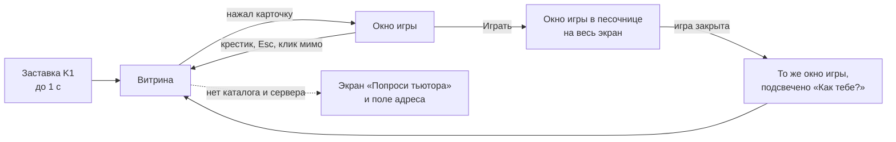

# ADR-0003: Витрина игр в приложении ученика

**Статус:** принято 03.11.2026 с решениями Влада (раздел 10, они главнее разделов 1–9). Макет: https://claude.ai/artifact/K1DsPMWvpzSYDwFkWCRyXa
**Дата:** 03.11.2026
**Решают:** Влад, Кирилл
**Уточняет:** ADR-0002. Сеть, подпись каталога, роли, обнаружение и защита оценок остаются как там. Этот документ описывает, что видит ребёнок, и что для этого нужно добавить в формат, каталог и этапы.

## Коротко

Приложение ученика открывается сразу на витрину: серый фон, крупный знак K1, сетка карточек с картинкой игры. Нажатие на карточку открывает небольшое окно с анимацией. В нём картинка режима, описание, кнопка «Играть», крестик и строка оценки «Как тебе?». Оценить можно только режим, в который ребёнок уже сыграл на этом занятии. Аккаунтов и имён нет.

Новое по сравнению с ADR-0002:

- **Обложки.** У игры и у каждого режима может быть картинка. Автор кладёт её в `.kibgames`, панель тьютора берёт её из проверенного файла и кладёт в каталог отдельным файлом. Так витрина показывает картинку до того, как скачана сама игра.
- **Оценка живёт в окне игры на витрине**, а не в отдельном диалоге после игры. После закрытия игры приложение возвращает ребёнка в то же окошко, и строка оценки подсвечена.
- **Две разные программы видны с первого взгляда:** у ученика знак K1 на светлом, у тьютора тот же знак на тёмном с полосой «Тьютор» и другим названием окна.

## 1. Как я понял задачу

| Хочет Влад | Как это сделано в проекте |
| --- | --- |
| Витрина игр, которые админ добавил на локальный сервер со своего ноутбука через `.kibgames` | Как в ADR-0002: публикация только в панели тьютора, каталог подписан ключом школы |
| Игры могут делать и другие разработчики | Как сейчас: любой автор с ключом из `kibpack`, тьютор видит автора и решает, публиковать ли |
| У детей тоже exe, но без админских прав | Отдельная сборка ученика: в ней нет панели, сервера и ключа (ADR-0002, 2.1). Установку делает тьютор один раз с правами администратора, дальше программа работает под обычной записью ребёнка |
| Заметный логотип K1 | Значок exe, ярлык, шапка витрины, заставка при загрузке (раздел 4) |
| Нажал режим → окно с анимацией, картинка, «Играть», крестик в углу, выбор оценки | Раздел 3 |
| Картинка и на витрине, и в окне | Обложка игры на карточке, обложка режима в окне (раздел 5) |
| Понять, что детям зашло | Оценки режимов из ADR-0002, 3.8. Цифры видит тьютор в панели |
| Без аккаунтов, максимум username позже | Сейчас ничего не вводится. Задел в разделе 7 |
| Серый фон, без градиентов, без «нейросетевого» вида, свой стиль | Раздел 4 |

**Допущение о слове «режим».** В разговоре «режим» значит и игру на витрине, и вариант внутри игры. В проекте оставляю определение из ADR-0002: режим — вариант запуска внутри игры. Карточка на витрине — это игра, а режимы выбираются вкладками в её окне. У игры с одним режимом вкладок нет, и для ребёнка разницы не видно. Это вопрос 1 в разделе 9.

**Допущение о крестике.** «В верхнем первом углу» читаю как «в верхнем правом»: там его ищут по привычке Windows. Вопрос 4.

## 2. Экраны и состояния



### 2.1 Витрина

```
┌──────────────────────────────────────────────────────────────────────────┐
│ ▐K1▌ Игры KIBERone                                        ● есть связь   │
├──────────────────────────────────────────────────────────────────────────┤
│  ВСЕ   КИБЕРБЕЗОПАСНОСТЬ   ЛОГИКА   ДВОИЧНАЯ СИСТЕМА        4–5 класс ▾  │
│                                                                          │
│  ┌──────────────┐  ┌──────────────┐  ┌──────────────┐  ┌──────────────┐  │
│  │   обложка    │  │   обложка    │  │   обложка    │  │   обложка    │  │
│  │    16:10     │  │    16:10     │  │    16:10     │  │    16:10     │  │
│  ├──────────────┤  ├──────────────┤  ├──────────────┤  ├──────────────┤  │
│  │ Киберпочта   │  │ Взломай сейф │  │ …            │  │ …            │  │
│  │ 30 мин · 4–5 │  │ 30 мин · 5–7 │  │              │  │              │  │
│  │ ▮▮▮▮▮▯▯ 64 % │  │ ✓ готово     │  │ нужна связь  │  │ НОВОЕ        │  │
│  └──────────────┘  └──────────────┘  └──────────────┘  └──────────────┘  │
└──────────────────────────────────────────────────────────────────────────┘
```

- Сетка 4 колонки при 1920 px, 3 при 1366 px, 2 при узком окне. Окно открывается развёрнутым.
- Фильтр по теме строится из поля `topic` каталога. Фильтр класса из `grades`, по умолчанию «все». Поиска нет: при десятках игр он не нужен.
- Порядок: сначала то, что тьютор отметил «на этом занятии», потом новые, потом остальные по названию. Сортировки по оценкам на витрине ребёнка нет (вопрос 3).
- Метка «НОВОЕ» держится 14 дней после публикации, дата берётся из каталога.

**Состояния карточки.** Ребёнок должен понимать, почему кнопка не нажимается.

| Состояние | На карточке | Кнопка в окне |
| --- | --- | --- |
| Скачана и проверена | `✓ готово` | «Играть» |
| Качается | Полоса и проценты | «Играть» с прогрессом, нажатие ставит игру первой в очередь (ADR-0002, раздел 6) |
| Нет в кеше, сервер не отвечает | `нужна связь`, обложка приглушена | Неактивна: «Попроси тьютора включить раздачу» |
| Проверка не прошла 3 раза | `не скачалась` | Неактивна: «Скажи тьютору: игра не скачалась» |
| Нужна новая версия приложения | `обнови приложение` | Неактивна, тот же текст |

### 2.2 Окно игры

```
                ┌───────────────────────────────────────────┐
                │ Киберпочта                             ✕  │
                │ ┌───────────────────────────────────────┐ │
                │ │                                       │ │
                │ │        обложка режима 16:10           │ │
                │ │                                       │ │
                │ └───────────────────────────────────────┘ │
                │ [ Тренировка ] [ Экзамен ]                │  ← вкладки, если режимов больше одного
                │ Разбери письма и найди мошенников.        │
                │ 30 мин · 4–5 класс · Кибербезопасность    │
                │                                           │
                │ ┌─────────────────────┐                   │
                │ │       ИГРАТЬ        │                   │
                │ └─────────────────────┘                   │
                │ ───────────────────────────────────────── │
                │ Как тебе?   [ Не моё ] [ Норм ] [ Супер ] │
                └───────────────────────────────────────────┘
```

- Ширина 720 px, по центру, витрина за окном затемнена серым на 40 %, без размытия.
- Закрыть можно крестиком, клавишей Esc и щелчком по затемнению. Крестик 44 × 44 px: у младших детей неточная мышь и тачпад.
- Фокус клавиатуры сразу на «Играть», Tab ходит только внутри окна, после закрытия фокус возвращается на карточку.
- Вкладки режимов меняют обложку, описание и строку оценки. Кнопка «Играть» запускает выбранный режим.

### 2.3 Оценка

Шкала из ADR-0002 (3.8): три варианта. В окне это три кнопки со словом и простой картинкой из линий, без эмодзи:

| Значение | Подпись | Картинка |
| --- | --- | --- |
| 1 | Не моё | Рожица с прямым ртом |
| 2 | Норм | Рожица с лёгкой улыбкой |
| 3 | Супер | Рожица с широкой улыбкой и K1-искрой |

Правила:

| Ситуация | Что видит ребёнок |
| --- | --- |
| Режим ещё не запускали на этом занятии | Кнопки серые, подпись «Сыграй, чтобы оценить» |
| Только что закрыл игру | Окно открыто заново, строка «Как тебе?» мигает рамкой один раз |
| Нажал оценку | Кнопка залита, под ней «Отправлю через 5 с · Передумал?». Через 5 с голос уходит, отменить уже нельзя |
| Уже оценил на этом занятии | «Ты поставил: Супер. Спасибо!», кнопки неактивны |
| Сервера нет | Голос ждёт в памяти, подпись «Отправлю, когда будет связь». При закрытии приложения он теряется (ADR-0002) |

Пять секунд на отмену нужны, потому что дети промахиваются, а сервер второй голос не примет (ответ 409). Перед отправкой приложение проверяет, что режим действительно запускался в этом окне оценок. Сервер это проверить не может, поэтому защита от накрутки остаётся такой, как описано в ADR-0002, и не обещает большего.

## 3. Анимация

Без пружин, отскоков и «вылетающих» элементов. Две короткие анимации.

| Что | Как | Время |
| --- | --- | --- |
| Открытие окна | Окно вырастает из прямоугольника карточки в центр (FLIP: `transform` и `opacity`), затемнение появляется параллельно | 200 мс, `cubic-bezier(0.2, 0, 0, 1)` |
| Закрытие | То же обратно в карточку | 150 мс |
| Наведение на карточку | Карточка сдвигается на 2 px вверх-влево, жёсткая тень растёт с 4 до 6 px | 80 мс |
| Нажатие | Карточка вдавливается: тень 0 px, сдвиг 4 px вниз-вправо | мгновенно |
| Заставка | Знак K1 появляется, полоска загрузки каталога под ним | до 1 с, пропускается, если каталог в кеше |

Если в Windows отключены эффекты анимации (`prefers-reduced-motion`), окно просто появляется. Анимируются только `transform` и `opacity`, чтобы слабые ноутбуки не дёргались.

## 4. Внешний вид

### 4.1 Направление

Образ: **«лабораторный стенд»**. Серая столешница, на ней белые плашки с толстым чёрным контуром и жёсткой тенью без размытия, как детали, вырезанные из пластика. Подписи-«маркировки» моноширинным шрифтом, как на плате. Один яркий акцент для действия. Это опирается на то, что школа учит программированию и электронике, и отличается от типовых витрин с карточками в мягких тенях.

Чего не делаем: градиентов, стекла и размытия, неоновых свечений, фиолетово-синих «нейросетевых» сочетаний, эмодзи в интерфейсе, иллюстраций в стиле 3D-аватаров, закруглений больше 8 px, текстов вроде «Откройте мир возможностей».

### 4.2 Токены

Цвет бренда KIBERone пока не подтверждён (вопрос 2). До ответа акцент — заглушка, его легко заменить одной переменной.

| Токен | Значение | Где |
| --- | --- | --- |
| `--bg` | `#D9D9D6` | Фон витрины, тёплый серый |
| `--bg-dim` | `#CACAC6` | Полоса фильтров, приглушённые обложки |
| `--plate` | `#FFFFFF` | Карточки и окно |
| `--ink` | `#151515` | Текст, контуры 2 px, тени |
| `--ink-2` | `#5A5A57` | Второстепенный текст |
| `--accent` | `#FF5A1F` (заглушка) | Кнопка «Играть», знак K1, выбранная оценка |
| `--ok` | `#1F8A4C` | «готово», точка связи |
| `--warn` | `#B26B00` | «нужна связь» |
| `--shadow` | `4px 4px 0 var(--ink)` | Тень плашек, без размытия |
| `--radius` | `6px` | Все плашки |

Контраст `--ink-2` на `--plate` и на `--bg` проверить по WCAG AA на прототипе.

### 4.3 Шрифты

Сети нет, поэтому шрифты лежат внутри приложения, CDN нельзя.

- **Golos Text** (OFL, есть кириллица) для названий и текста. Заголовки 600, текст 400, минимум 16 px, в окне игры 18 px: среди детей есть читающие медленно.
- **JetBrains Mono** (OFL) для маркировок: `30 мин · 4–5`, `✓ готово`, вкладки фильтра заглавными.

### 4.4 Знак K1

- Квадрат цвета `--accent` с чёрным контуром 2 px и жёсткой тенью, внутри «K1» жирным, «1» чуть ниже, как индекс. Это своё начертание, а не логотип школы: если есть официальный знак KIBERone и его разрешено использовать, берём его (вопрос 2).
- Где: значок `.exe` и ярлыка (`.ico` 16–256 px), шапка витрины, заставка, заголовок окна игры (`K1 · Киберпочта`), чтобы ребёнок понимал, что игра запущена из школьной программы.
- **Программа тьютора:** тот же знак на чёрном с жёлто-чёрной полосой «ТЬЮТОР» и окно «KIBERone Сервер». Дети не должны путать программы, и тьютор сразу видит, где он находится. Пароль тьютора вводится только в этом окне и никогда на ноутбуке ученика (ADR-0002, 3.2).

### 4.5 Обложка, если её нет

Авторы будут забывать картинку. Тогда приложение рисует заглушку само: серая плашка с крупными первыми буквами названия и узором из линий «дорожек платы». Узор выбирается по `id` игры, поэтому заглушки разных игр отличаются, но выглядят одинаково аккуратно. Градиентов нет и здесь.

## 5. Изменения формата и каталога

### 5.1 Манифест `.kibgames`

Сейчас в корне архива разрешён только `icon.png`, а новые поля манифеста `checkManifest` отвергает. Добавляется одно необязательное поле `cover` у игры и у каждого режима (поле `modes` уже запланировано в ADR-0002, 3.6):

```json
{
  "cover": "game/cover.png",
  "modes": [
    { "id": "training", "title": "Тренировка", "cover": "game/cover-training.png",
      "about": "Письма с подсказками" },
    { "id": "exam", "title": "Экзамен", "entry": "game/exam.html", "cover": "game/cover-exam.png",
      "about": "Без подсказок, на время" }
  ]
}
```

| Проверка | Значение |
| --- | --- |
| Путь | Есть в `files`, начинается с `game/`, существующая `checkPath` |
| Тип | PNG или WebP по первым байтам файла, не по расширению. JPEG не берём: в нём часто GPS-координаты из EXIF, а резать метаданные в приложении не хочется |
| Размер | До 512 КБ, рекомендуемо 1280 × 800 (16:10). Другие пропорции обрезаются по центру при показе |
| `about` у режима | Существующая проверка текста, до 120 знаков |
| Если поля нет | Заглушка из раздела 4.5 |

**Почему это безопасно.** Поле описывает картинку, которую уже проверила подпись автора, и не даёт игре новых прав. Как и с `modes`, старая версия приложения откажется открывать такую игру с понятной ошибкой, `format` остаётся 1. `kibpack` получает проверку и предупреждение, если обложки нет.

### 5.2 Каталог

При публикации панель тьютора после `readPackage` достаёт обложки из уже проверенных байтов и кладёт их в `blobs/<sha256>` рядом с игрой. Картинку панель **не перекодирует**: разбор чужого изображения в основном процессе — лишний риск. Картинку разбирает только окно витрины, у которого нет сети, Node и доступа к файлам.

В записи игры каталога из ADR-0002 (3.4):

```json
"cover": { "sha256": "…", "bytes": 182000 },
"publishedAt": "2026-11-03",
"lesson": true,
"modes": [
  { "id": "training", "title": "Тренировка", "about": "Письма с подсказками",
    "cover": { "sha256": "…", "bytes": 160000 } }
]
```

- Обложки качаются сразу после каталога, раньше самих игр, с тем же путём `/v1/blobs` и проверкой `sha256`. Для 20 игр по 3 обложки до 512 КБ это до 30 МБ на ноутбук один раз, на классе 450 МБ: 3 минуты при 20 Мбит/с, меньше 30 с при 150 Мбит/с. Чтобы витрина не ждала, сначала грузятся обложки игр, потом обложки режимов. Это вписывается в правила раздела 6 ADR-0002, но предел 64 КБ для значка остаётся только у значка.
- Если хочется меньше трафика, следующий шаг — превью 640 × 400 до 96 КБ, которое делает `kibpack` у автора. Пока не делаю: лишнее требование к авторам.
- `publishedAt` нужен для метки «НОВОЕ», `lesson` — отметка тьютора «на этом занятии». Обе подписаны вместе с каталогом.

### 5.3 Окно витрины

Как в ADR-0002 (4.1): своя схема `kibapp://`, закрытая сессия, без сети и Node. Обложки окно получает только как `kibapp://cover/<sha256>`, а основной процесс отдаёт их из кеша после проверки хеша. CSP окна: `img-src kibapp:`, `font-src kibapp:`, без `connect-src` наружу. Все тексты из каталога выводятся через `textContent`, никакой разметки.

IPC окна витрины остаётся в списке из ADR-0002: `catalog.list`, `game.launch(id, mode)`, `vote.send`, `server.setAddress`. Добавляется одно событие из основного процесса: `game.closed(id, mode)`, по нему витрина снова открывает окно игры с подсвеченной оценкой. Окно игры (песочница) ничего нового не получает.

## 6. Ошибки понятным языком

Отчёт с Windows (находка 4) показал английский заголовок «Error» и технический хвост от ZIP-библиотеки. В приложении ученика ребёнок вообще не видит технических ошибок:

| Что случилось | Что видит ребёнок | Что видит тьютор (журнал в «О программе», только память) |
| --- | --- | --- |
| Файл не прошёл проверку | «Игра не скачалась. Скажи тьютору» | Причина: хеш, подпись, размер |
| Сервер не найден | Экран «Попроси тьютора» | Какие способы обнаружения пробовались |
| Игра не запустилась | «Эта игра сейчас не открывается» | Текст ошибки |

Окна `dialog.showErrorBox` в сборке ученика не используются: все сообщения рисует витрина на русском. В сборке тьютора исправляем заголовок окна ошибки и разделяем «файл повреждён» и «файл изменён после подписи».

## 7. Имя ученика: задел, не делаем

Сейчас имени нет нигде. Когда появятся мультиплеерные режимы:

- ник вводится на витрине перед входом в комнату, хранится только в памяти до закрытия приложения;
- ник не прикрепляется к оценкам никогда: иначе оценки перестают быть анонимными, и это меняет обещание из ADR-0002;
- в шапке витрины для этого оставлено место справа от точки связи.

Решать это будем вместе с каналом мультиплеера (ADR-0002, раздел 9).

## 8. Как это ложится на этапы ADR-0002

Вперёд добавляется маленький этап без сети, чтобы показать витрину детям раньше, чем готов сервер.

### Этап В0. Кликабельный прототип витрины

**Цель:** согласовать вид и поведение витрины с Владом, Кириллом и детьми до того, как писать сетевую часть.

**Входит:** одна HTML-страница в `app/desktop/client/ui/` с тремя-четырьмя играми из заглушки каталога, карточки, окно с анимацией, вкладки режимов, оценка с отменой, все состояния карточки, знак K1, шрифты внутри папки. Открывается в браузере без сети.
**Не входит:** Electron, сеть, настоящая отправка оценок, панель тьютора.

| Критерий | Как проверить |
| --- | --- |
| Работает без интернета | Открыть файл при выключенной сети, в DevTools нет внешних запросов |
| Окно открывается из карточки и закрывается крестиком, Esc и щелчком мимо, фокус возвращается | Вручную, мышью и клавиатурой |
| Все пять состояний карточки из 2.1 видны и понятны | Переключатель состояний в заглушке, просмотр Владом |
| Оценка недоступна до «сыгранного» режима, отменяется 5 с | Вручную |
| При `prefers-reduced-motion` анимации нет | Включить в DevTools |
| Нет градиентов, `backdrop-filter`, теней с размытием | Поиск `gradient`, `blur` в CSS |
| Контраст текста по WCAG AA | Проверка в DevTools на каждом цвете текста |
| Вид на 1920 и 1366 px | Снимки экрана в `docs/img/` |
| Дети понимают без объяснений, как запустить игру и оценить | Показать 3–4 ученикам на перемене, тьютор записывает, где застряли. Данные о детях не собираем |

### Изменения в существующих этапах

| Этап | Что добавляется |
| --- | --- |
| М1 | Панель тьютора: вывод обложки при публикации, отметка «на этом занятии». Проверка `cover` в `shared/` и `kibpack`, модульные тесты: JPEG, подмена расширения, файл больше 512 КБ, путь вне `game/` отвергаются |
| М2 | Витрина из прототипа В0 становится окном каталога. Загрузка обложек раньше игр. Экран «Попроси тьютора». Сообщения об ошибках из раздела 6. Новый критерий К23: окно витрины не делает сетевых запросов и не выполняет разметку из каталога (название с ``), контроль — версия без CSP выполняет |
| М3 | Порядок загрузки: обложки игр, обложки режимов, игры |
| М4 | Строка оценки в окне, отмена 5 с, событие `game.closed`, вкладки режимов. Рейтинг виден только в панели тьютора (если вопрос 3 решён так) |
| М5 | Значки `.ico` двух программ, заставка, снимки экрана в README |

## 9. Вопросы перед этапом В0

1. Карточка на витрине — это игра, а режимы выбираются вкладками внутри её окна? По умолчанию да.
2. Есть ли официальный знак и цвета KIBERone, которые можно использовать в программе? По умолчанию рисуем свой знак K1 и акцент `#FF5A1F`, потом заменяем одной переменной.
3. Показывать ли детям, какие игры нравятся группе? По умолчанию нет: на пилоте дети видят только свои оценки, цифры видит тьютор, чтобы чужие оценки не влияли на детские.
4. Крестик в правом верхнем углу окна? По умолчанию да.
5. Шкала оценки из трёх вариантов «Не моё / Норм / Супер», как в ADR-0002? По умолчанию да.

## 10. Решения Влада от 03.11.2026

Где этот раздел расходится с разделами выше или с ADR-0002, верен он.

| Вопрос | Решение | Что меняется |
| --- | --- | --- |
| Карточка — игра или режим | Решает автор игры. Можно сделать один режим и выбор внутри игры, а можно объявить несколько режимов в манифесте, и тогда они видны вкладками на витрине | `modes` остаётся необязательным полем. Без него у игры один режим `default`, вкладок нет |
| Знак и название | «K1 Игры». Официальный KIBERone есть, но в программе остаётся свой знак K1 | Раздел 4.4 в силе |
| Показывать ли детям оценки | Да: звёзды и среднее на карточке и в окне игры | Раздел 2.1 «сортировки по оценкам нет» и вопрос 3 отменены. Порог «мало оценок» при `n < 5` из ADR-0002 оставляем, чтобы одна оценка не давала 5.0 |
| Шкала | 5 звёзд, среднее до 5.0 с одним знаком после запятой | Таблица из раздела 2.3 и три варианта из ADR-0002 3.8 заменены на 1–5 звёзд |
| Защита от повторов | Базовая: один режим можно оценить один раз в день с одного ноутбука (уточнено Владом позже 03.11.2026) | См. «Одна оценка в день» ниже. Потолок на окно из ADR-0002 3.8 убирается |
| Хранение | Простой счётчик на сервере тьютора: словарь «игра → режим → звёзды → количество» | См. ниже |

Формат `ratings.json` на ноутбуке тьютора:

```json
{
  "format": 1,
  "games": {
    "labirint-robota": {
      "training": { "1": 0, "2": 1, "3": 1, "4": 4, "5": 8 },
      "exam":     { "1": 0, "2": 0, "3": 0, "4": 3, "5": 12 }
    }
  }
}
```

- Нет имён, адресов и времени, только количество. Среднее считается при показе: `сумма(звёзды × количество) / сумма(количество)`.
- Ключи `game` и `mode` сервер принимает, только если они есть в текущем подписанном каталоге, иначе любой ноутбук может добавить в файл мусор. Значение только целое от 1 до 5.
- Счётчики за день из ADR-0002 3.7 не нужны. Чтобы смотреть, как меняется отношение к игре, тьютор может выгрузить копию файла кнопкой «Сохранить срез» (имя файла с датой). Если позже понадобятся дни, добавим уровень `"2026-11-03"` над `games`.
### Одна оценка в день

Две проверки, обе без имён:

| Где | Как | Что хранится |
| --- | --- | --- |
| Программа ученика | Перед показом звёзд смотрит, оценивал ли этот ноутбук режим сегодня. Если да: звёзды неактивны, подпись «Ты уже оценил этот режим сегодня. Завтра можно снова» | `state.json` в `%LOCALAPPDATA%`: `{"votedOn": "2026-11-03", "voted": ["labirint-robota/exam"]}`. Только факт, без звёзд. При смене даты список очищается |
| Сервер тьютора | Принимает один голос в день на пару «адрес + игра + режим», повтор получает 409 | Только память: множество `HMAC(соль дня, адрес + игра + режим)`. Соль новая каждый день и при перезапуске, на диск не пишется. Адресов в `ratings.json` нет |

День считается по часам ноутбука тьютора, ученику сервер сообщает дату в ответе каталога, чтобы не зависеть от неверных часов на ноутбуке ученика.

Что это не закрывает: ученик, который очистит `state.json` и сменит IP-адрес или напишет свою программу. От случайного и обычного спама кнопкой защищает. Два ребёнка за одним ноутбуком в один день дадут одну оценку. Перезапуск сервера посреди дня позволит оценить ещё раз, это принято.

Вид из макета главнее раздела 4.2, полное описание стиля в [`docs/stil-k1.md`](../stil-k1.md): фон `#D6D9DC`, акцент `#FF5B14`, скругления 0, второстепенный текст `#4A4F55`, выбранное состояние инверсией (`#111` и белый текст).
