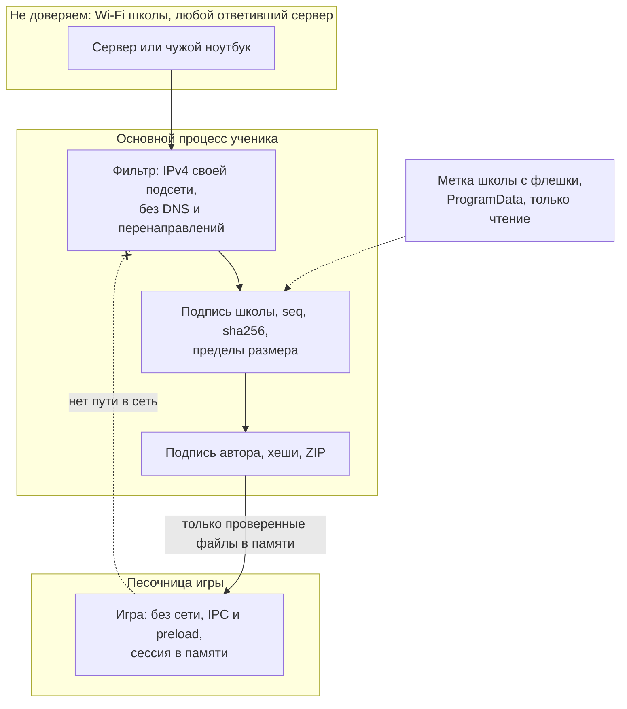

# Безопасность: что обещаем и что нет

Для тьютора, администратора школы и разработчика. Подробная модель угроз — [ADR-0002, раздел 4](adr/0002-marketplace.md), оценки — [ADR-0003, раздел 10](adr/0003-vitrina.md).

## Обещаем

- **Игра не выходит из песочницы.** Без сети, без файлов компьютера, без камеры, микрофона и буфера обмена. Всё, что ребёнок ввёл в игре, живёт в памяти до закрытия окна, на диск и в сеть не попадает.
- **Ученик запускает только то, что одобрил тьютор.** Каталог подписан ключом школы, файл игры сверяется с хешем из каталога и с подписью автора. Подмена файла, каталога или сервера в Wi-Fi не проходит. На настроенном ноутбуке посторонний `.kibgames` не открывается.
- **Данные не покидают сеть школы.** Программы не ходят в интернет: нет телеметрии, автообновления, DNS. Ученик говорит только с адресами своей подсети, сервер тьютора отвечает только им, правило брандмауэра — `localsubnet`.
- **Оценки без имён.** На ноутбуке тьютора хранится только «сколько раз поставили каждую звезду каждому режиму». Адресов и времени голоса нет.
- **Ученик не меняет метку школы.** `C:\ProgramData\KIBERone Games` после установщика принадлежит «Администраторам», ученикам — только чтение.
- **Ключ школы на диске только зашифрован** паролем тьютора (scrypt, AES-256-GCM) и, отдельной копией, кодом восстановления. Через 10 минут без действий ключ стирается из памяти.

## Не обещаем

- **Ученик с правами администратора** (его запись в группе «Администраторы» или у администратора нет пароля) управляет своим ноутбуком: может подменить метку, программу и кеш. Только на этом ноутбуке: ключа школы там нет, другие ноутбуки и каталог не затронуты. Лечится обычной записью для детей и паролем администратора.
- **Без шифрования в Wi-Fi.** Кто перехватывает трафик, видит список игр и голоса с адресами и может исказить рейтинг на экране. Секретов в сети нет: пароль тьютора по сети не ходит, игры подписаны, а не секретны.
- **Любое устройство в сети школы** может скачать каталог и файлы игр. Если в Wi-Fi пускают гостей, они тоже смогут.
- **Содержимое игры никто не проверяет автоматически.** Игра может показать неподходящее или попросить ввести личные данные, хотя отправить их не сможет. Поэтому тьютор публикует только игры, которые сам запускал.
- **Неподписанные установщики.** Windows покажет SmartScreen. Хеши — в `SHA256SUMS.txt` рядом с установщиками.
- **Уязвимость в самом Chromium** (Electron 45). Обновления выпускаем вручную.

## Что защищают оценки и чего нет

| Защищает | Не защищает |
| --- | --- |
| Один ноутбук оценивает режим раз в день: витрина не даёт, сервер отвечает 409 на повтор, даже если ребёнок удалил отметку у себя | Ребёнок со своей программой и сменой адреса голосует по разу с каждого адреса подсети |
| Мусор (чужие игры и режимы, не 1–5, большие тела, запросы из браузера) не попадает в счётчик | Перезапуск программы тьютора начинает день заново: тот же ноутбук сможет оценить ещё раз |
| Распределение звёзд скрыто, пока оценок меньше 5 | Если голосуют по одному, по изменению среднего видно, как проголосовал сосед |
| Голоса не мешают раздаче и не идут во время игры | Голос, не успевший уйти, пропадает при закрытии программы ученика |

Рейтинг показывает настроение класса. Не используйте его для оценок и начислений.

## Что где лежит

| Что | Где | Личные данные |
| --- | --- | --- |
| Ключ школы, зашифрованный | Тьютор: `%LOCALAPPDATA%\KIBERone Server\school-key.enc` | Нет |
| Каталог, файлы игр | Тьютор: `…\catalog.json`, `…\blobs\` | Нет |
| Список доверенных авторов | Тьютор: `…\trusted-keys.json` | Имена авторов игр, не детей |
| Оценки | Тьютор: `…\ratings.json`, срезы с датой — где сохранил тьютор | Нет: игра, режим, звезда, количество |
| Защита от повторного голоса | Тьютор: только память, соль меняется каждый день и при запуске | Нет на диске |
| Метка школы | Ученик: `C:\ProgramData\KIBERone Games\school.json` | Нет, только открытый ключ |
| Кеш игр, последний каталог | Ученик: `%LOCALAPPDATA%\KIBERone Games\` | Нет |
| «Сегодня уже оценил» | Ученик: `%APPDATA%\Игры KIBERone\state.json` | Нет, только игра и режим |
| Хранилище игры | Ученик: только память | Может содержать введённое ребёнком, не пишется |

## Кому что доверяем

## Как мы это проверяем

Тест-«взломщик» (`app/redteam/`) атакует настоящие программы: игра пытается выйти в сеть, прочитать файлы, открыть окна; поддельный сервер подсовывает каталог и файлы; скрипт ученика шлёт мусор и повторные голоса. Для каждой атаки есть **контрольный прогон без защиты**: если без защиты атака не сработала, тест считается проваленным, потому что ничего не доказал. Отключение защиты есть только в `app/redteam/`, в сборки оно не попадает: это проверяет `npm run check:builds`. Список критериев К1–К29 и результаты — в отчётах [`docs/tasks/`](tasks/), команды — в [`app/README.md`](../app/README.md).
