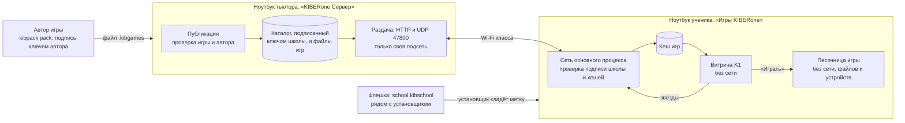
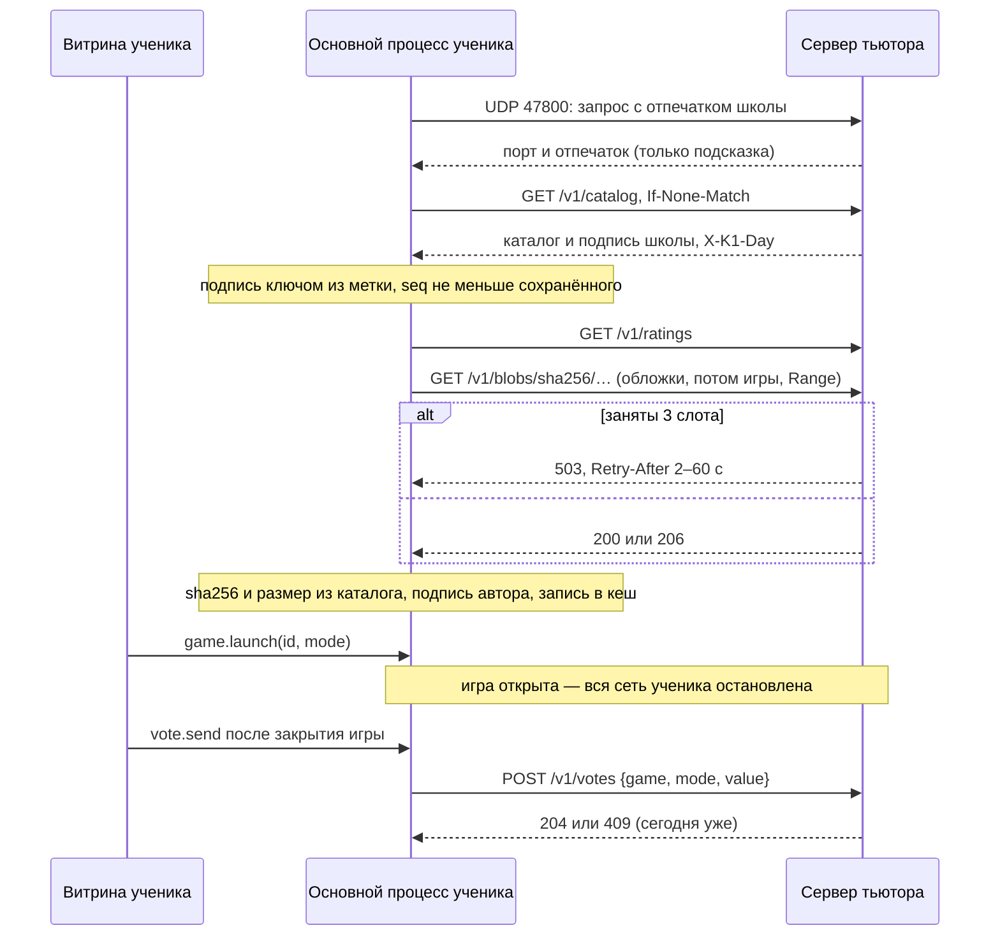

# Как устроено

Для разработчика. Почему так, а не иначе, — в [ADR-0001](adr/0001-prilozhenie-kibgames.md), [ADR-0002](adr/0002-marketplace.md) и [ADR-0003](adr/0003-vitrina.md); здесь то, что сделано на деле после этапа М5. Команды сборки и тестов — в [`app/README.md`](../app/README.md), защита — в [`bezopasnost.md`](bezopasnost.md).

## Как игра попадает к ученику

Код один, программ две. Сборка ученика — `app/package.json`, сборка тьютора — `app/builder-tutor.json`. В сборку ученика код тьютора не попадает: это проверяет `npm run check:builds` (Т14, К19).

| Папка | Что | Ученик | Тьютор |
| --- | --- | --- | --- |
| `app/shared/` | Формат `.kibgames`, проверка каталога и метки, оценки, выбор сети | да | да |
| `app/desktop/sandbox.js` | Песочница игр | да | да, для пробного запуска |
| `app/desktop/main.js`, `school-net.js`, `vitrina/` | Программа ученика: витрина, сеть, кеш | да | нет (только шрифты) |
| `app/desktop/tutor/` | Ключ школы, публикация, сервер, голоса, окно тьютора | **нет** | да |
| `app/build/` | Значки и NSIS-скрипты установщиков (М5) | — | — |
| `app/kibpack/` | Упаковка и подпись игр, для авторов | нет | нет |

## Запуск и загрузка по шагам

## Установщики (М5)

Оба — NSIS от electron-builder, `perMachine: true`, значки `app/build/icon.ico` и `app/build/tutor/icon.ico` (рисует `app/scripts/make-icons.py`). Свои шаги — в `app/build/installer.nsh` (метка школы) и `app/build/tutor/installer.nsh` (брандмауэр). Обе программы при запуске показывают заставку на 3 с (`ui/splash.js`): знак, три шага, выдуманная полоса загрузки. Каталог за это время грузится сам, заставка его не ждёт. Собираются только на Windows: `.github/workflows/build-windows.yml` или `npm run build:win` и `npm run build:tutor-win` на Windows, проверка — `node scripts/check-installers.js`.

## Витрина без метки школы

Без файла в аргументах приложение открывает витрину. Игры берутся из `%APPDATA%\Игры KIBERone\games\`, каждая проверяется так же, как при запуске файла. Список доверенных авторов на таком ноутбуке — `%APPDATA%\Игры KIBERone\trusted-keys.json`: `{ "отпечаток ключа": "Имя" }`, отпечаток показывает `kibpack verify`. Двойной щелчок по `.kibgames` открывает игру автора не из списка только после предупреждения. Игры авторов не из `trusted-keys.json` видны с меткой «автор не проверен», запустить их с витрины нельзя. Оценки пишутся в `ratings.json`, отметка «сегодня уже оценил» в `state.json` в той же папке данных. На настроенном ноутбуке (М4) `ratings.json` ученика не пишется: оценка уходит на сервер тьютора, в `state.json` остаётся только отметка дня.

Код: `app/desktop/vitrina/` (окно, IPC, каталог, хранилище) и `app/desktop/vitrina/ui/` (страница, стили, шрифты Golos Text и JetBrains Mono под OFL). Логика оценок: `app/shared/ratings.js`.

## Программа тьютора

Данные лежат в `%LOCALAPPDATA%\KIBERone Server\` (на Linux `~/.local/share/KIBERone Server/`):

| Файл | Что в нём |
| --- | --- |
| `school-key.enc` | Закрытый ключ школы Ed25519, только зашифрованный: копия под паролем и копия под кодом восстановления (scrypt N = 2^17, AES-256-GCM) |
| `school.kibschool` | Название школы, открытый ключ и отпечаток. Секрета нет, этот файл ставится на ноутбуки учеников |
| `login.json` | Счётчик ошибок входа: задержка растёт до 60 с и не сбрасывается перезапуском |
| `catalog.json` | Подписанный каталог `{ payload, sig }`: подпись Ed25519 над `kibcatalog-v1\n` + содержимое. Это и есть список игр школы |
| `blobs/<sha256>` | Файлы опубликованных игр и их обложки, без расширения |
| `trusted-keys.json` | Список доверия школы: `{ "отпечаток ключа автора": "Имя" }` |
| `ratings.json` | Оценки учеников в формате ADR-0003, раздел 10: только сколько раз поставили каждую звезду каждому режиму. Адресов и времени нет. Копия с датой — кнопкой «Сохранить срез» |

Через 10 минут без нажатий мыши и клавиш ключ в памяти затирается и программа просит пароль снова.

**Раздача** (этап М2, `app/desktop/tutor/server.js`): выключена при каждом запуске, тьютор включает её на плашке «РАЗДАЧА УЧЕНИКАМ» и выбирает сеть. VPN и виртуальные адаптеры в списке не показываются (`app/shared/netif.js`). Сервер только читает: `GET /v1/catalog` (`ETag` = `seq`, ответ 304) и `GET /v1/blobs/sha256/<hex>` для файлов из текущего каталога, порт 47800, TCP и UDP. Отвечает только адресам своей подсети, отвергает запросы с `Origin`, журнала запросов не ведёт. Работает и при закрытом ключе, пока включена — ноутбук не засыпает. Правило брандмауэра создаёт установщик (М5): вход TCP и UDP 47800 только для `kiberone-server.exe`, `remoteip=localsubnet`, все профили; удаление программы его снимает (`app/build/tutor/installer.nsh`).

**Нагрузка на сеть** (этап М3, ADR-0002, раздел 6): одновременно отдаются не больше 3 файлов больше 1 МБ, по одному на ноутбук, остальным `503` с `Retry-After` (через сколько секунд освободится слот, 2–60 с). Каталог и мелкие файлы идут вне очереди. Все файлы вместе — не быстрее 30 Мбит/с, кнопка «Скачать быстрее» на плашке снимает предел до выключения раздачи. На плашке видно, сколько ноутбуков качают и сколько ждут, без адресов. `Range` и `If-Range` (`ETag` — хеш файла) для докачки. Кнопка «На этом занятии» ставит игру первой на витрине и велит ноутбукам скачать её заранее при любом размере (`prefetch` в каталоге).

**Оценки** (этап М4, `app/desktop/tutor/votes.js`): `POST /v1/votes` с телом `{ "game", "mode", "value" }` до 256 байт, только игры и режимы текущего каталога, оценка 1–5. Ответы: 204, 400 (не то), 409 (этот ноутбук сегодня уже оценил режим), 413, 415, 429. Повтор узнаётся по `HMAC(соль дня, адрес + игра + режим)` в памяти; соль — случайные байты, тоже только в памяти, новая при смене даты и при запуске программы тьютора (выключение раздачи её не сбрасывает). `GET /v1/ratings` отдаёт число оценок по играм и режимам, распределение звёзд — только при 5 оценках и больше; среднее считает витрина. Каталог и рейтинг несут заголовок `X-K1-Day` — дату по часам тьютора. Голоса и рейтинг не занимают слоты и не тормозятся пределом скорости. Панель «Оценки» обновляется вместе с плашкой раздачи раз в 3 с.

## Настроенный ноутбук ученика (этапы М2–М4)

Метка школы — файл `school.kibschool` из программы тьютора. Установщик ученика (М5, `app/build/installer.nsh`) кладёт его из папки рядом с собой в `C:\ProgramData\KIBERone Games\school.json` (на Linux `/etc/kiberone-games/school.json`): владелец папки — «Администраторы», наследование снято, «Пользователям» только чтение. Папку-ссылку (junction) он снимает как ссылку. Удаление программы снимает метку, обновление — нет. Из исходников: `npx electron . --school=файл --local-data=папка`.

С меткой программа:
- ищет сервер: последний рабочий адрес, затем UDP на широковещательные адреса школьных сетей, через 15 с без каталога — экран «Попроси тьютора» с полем адреса;
- принимает каталог, только если он подписан ключом из метки и его `seq` не меньше сохранённого;
- качает обложки игр, обложки режимов, затем игры, по одному файлу; кладёт в кеш только файл с `sha256` и размером из каталога и игру, подписанную ключом автора из каталога;
- сама качает только игры до 20 МБ и отмеченные тьютором «На этом занятии». Остальные — по кнопке «Играть»: игра встаёт первой, другие загрузки на паузе, на кнопке процент и примерное время. Докачавшись, игра сама не запускается (М3);
- оборванная загрузка остаётся в `cache\<sha256>.part` и продолжается с места обрыва (`Range`), после загрузки файл проверяется целиком. Повторы через 5, 10, 20, 40, 60 с со сдвигом ±30 %. «Не скачалась» ставят только 3 неудачные проверки, обрыв связи — нет;
- кеш не больше 5 ГБ и не меньше 2 ГБ свободного места на диске. Если места нет, само ничего не качается, а «Играть» убирает игры не с этого занятия, которые дольше всего не запускались. Не помогло — «мало места»;
- запускает игру из кеша после новой проверки, на время игры останавливает всю сеть;
- отправляет оценки на сервер тьютора (М4): голос ждёт в памяти, пока идёт игра или нет связи, и уходит в начале следующего цикла. Звёзды на витрине — с сервера (`/v1/ratings`), день «одной оценки» — по дате тьютора. При закрытии программы неотправленный голос теряется;
- не открывает посторонние `.kibgames`, не читает `trusted-keys.json` и папку `games`.

| Файл | Что в нём |
| --- | --- |
| `%LOCALAPPDATA%\KIBERone Games\catalog.json` | Последний принятый каталог |
| `%LOCALAPPDATA%\KIBERone Games\state.json` | `seq`, последний адрес сервера, когда запускалась каждая игра |
| `%LOCALAPPDATA%\KIBERone Games\cache\<sha256>` | Игры и обложки. Снятые игры удаляются при новом каталоге |
| `%LOCALAPPDATA%\KIBERone Games\cache\<sha256>.part` | Недокачанное. Удаляется через 7 дней и при снятии игры |

Вся сеть программы ученика — в `app/desktop/school-net.js` (Node `http` и `dgram`, только IPv4 своей подсети, без DNS и перенаправлений). Логика каталога и кеша — `app/desktop/vitrina/net-source.js`. Проверка каталога для программы ученика (этап М2): `app/shared/catalog.js`, функция `verifyCatalog`. Подпись: `app/desktop/tutor/catalog-sign.js`.
